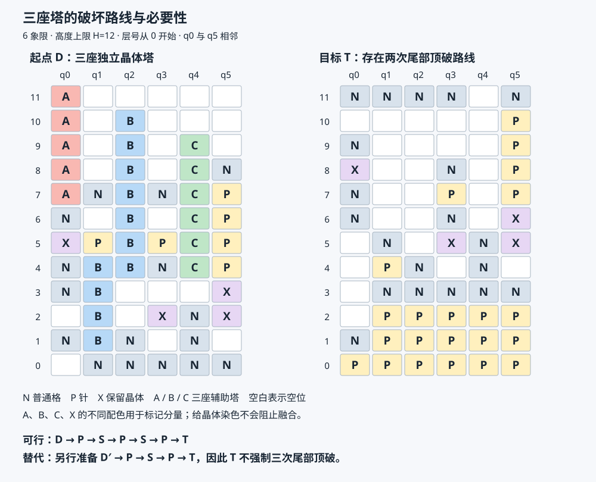

# 参考卷 07｜顶破约化与候选排除

本卷按专题保存完整论证。原文各节保留自己的符号与层号约定；阶段性工程数据以对应记录为准。统一阅读入口为[研究论文与资料](../papers/README.md)。

## 本卷目录

- [07-01 四象限三次顶破的几何限制与顶盖消去](#s07-01)

- [07-02 四象限DDLD尾部必有至多两次破坏的替代](#s07-02)

- [07-03 四象限DLᵣDD尾部可改为至多两次破坏](#s07-03)

- [07-04 四象限末两次顶破的短间隔改写](#s07-04)

- [07-05 四象限唯一低处释放与一次顶破的充分条件](#s07-05)

- [07-06 高处破坏可整体移入四象限起点准备](#s07-06)

- [07-07 四象限截短半形的首个支撑顶盖](#s07-07)

- [07-08 六象限最低两层来源的双顶破改写](#s07-08)

- [07-09 晶体封顶目标：带半形证书的零Pin改写](#s07-09)

- [07-10 加宽Wₖ的两种一次Pin替代：临时顶桥与新增屋顶落点](#s07-10)

- [07-11 三座晶体塔的尾部构造与两次顶破替代](#s07-11)

- [07-12 三塔的两次必要上料：固定起点五步与零尾针替代](#s07-12)

- [07-13 外部TMAM研究并入本模型的局部化简](#s07-13)


---

<a id="s07-01"></a>

## 07-01 四象限三次顶破的几何限制与顶盖消去

原文标识：`general/ceiling-destruction-bound.md`。

本页研究固定高度上限H、最后一次Swap之后只使用Pin和Stack的尾部。层号从0开始，N、P、C分别表示普通格、针和晶体。旋转吸收到起点与上料朝向。结论适用于四象限任意H≥2，依赖[四象限支撑闭包](01-foundations.md#s01-06)和[完整半边判据](02-four-quadrants.md#s02-13)。

**四象限不能让连续三次Pin都向顶层以下传播晶体破坏，中间插入任意Stack也不行。** 只删除顶层孤立晶体的Pin，还可以通过修改合法交换起点消去它的晶体破坏。因此，若一个四象限目标真的强制至少三次晶体破坏，其任何路线都至少含四次Pin。这个结论没有排除四次或更多Pin的路线，也没有解决六象限的全局三破坏目标。

外部材料`/mnt/d/Downloads/tmam-context-en.txt`的`CORE_RANK3_REPORT_KO`第512—568行提供了D/L划分、DDD排除和首次L吸收的论证。本页按本项目已经闭合的半形制造理论重新证明，并补充单层晶体分量替换及其对破坏次数的推论。外部摘要所述全高度rank≤3没有在此作为前提。

<a id="s07-01-h1"></a>

### 1. 区分向下顶破与截顶抬升

对Pin输入X定义：

- D：存在某列q，使X在(q,H−2)、(q,H−1)均为C。
- L：不存在这样的同列相邻CC。

D必定删除顶层以下的至少一颗C。L仍可能删除顶层C，但不会删除第H−2层及以下的C，也不会使下面的材料下落。

后一结论需要支撑论证。融合删除若从最高层向下传播，必跨过某条同列CC边；L没有这种边。最高层的非针组也全部限于这一层，因为非针组跨层同样只能经过CC边。它不能作为较低组的下方支撑。截去这些单层组及最高层针后，下面的原支撑证书仍在。抬升时，原地面占用由新地面针继续托住。因此L恰好是截顶、抬升一层和按地面占用补针。

这比“输入最高层没有C”的旧条件更宽，但仍不是所有Pin。D即使恰好没有普通格下落，也不属于L。

<a id="s07-01-h2"></a>

### 2. 连续三次D不可能

反设一段尾部中有连续三次Pin均为D；它们之间允许任意Stack。以第一次Pin前的坐标为准。Stack不增加保留C；幸存C在每次Pin中恰提高一层，不能下降后仍保留。不同C融合分量也不能靠Stack中新加的普通格融合。

第一次D在列a具有原第H−2、H−1层的CC。这两颗属于首次删除分量A。

第二次D在列b具有原第H−3、H−2层的CC，且它们必须撑过第一次Pin。两组在原第H−2层同时有C，故b既不能等于a，也不能与a相邻。四象限只剩：

`b = a+2 (mod 4)`。

第三次D在列c具有原第H−4、H−3层的CC，且它们必须撑过前两次Pin。同理，在原第H−3层与第二组分离要求：

`c = b+2 = a (mod 4)`。

可是第三组的上格(q=a,z=H−3)与第一组的下格(q=a,z=H−2)垂直相邻，原本就是同一个融合分量，第一次Pin已经全部删除。矛盾。

示意图只画构成矛盾的C，A、B、C表示拟定的不同删除分量：

```text
原层号       q=a       q=a+2
H−1           A          .
H−2           A          B
H−3           C          B
H−4           C          .
```

同列的A与C没有空格隔开，不能作为两个独立塔。

H<4时，第三组需要的原层号已经越过地面，同样不可能。中途另有晶体因下落碎掉，只会减少幸存分量，不能补回第三组。

<a id="s07-01-h3"></a>

### 3. 单层晶体分量可以在合法半形中改成普通格

设Q是一个合法两列半形，选取其中某些完整晶体融合分量，每个分量都只占一层。把这些C改成N，其余格位、普通格标签和针不变，得到Q̃。则Q̃仍是合法可制造半形。

<a id="s07-01-h4"></a>

#### 列条件保持

先对两列均通过文中B条件的网格X作相同替换。非针组的水平边保留；被替换C没有同列CC边，因此非针组及其支撑图不变。

逐项看[列判据](02-four-quadrants.md#s02-13-h1)：

- 占用不变，针的直接下邻不变；剩余C下面的针限制不变。
- 不会新建空洞，普通资源只增加；剩余非最高C的直接上盖仍非空。
- 最低剩余C只会提高，因此D条件不会变坏；地面针也不变。
- 剩余C段的长度和直接下邻不变；原三连晶终点、相邻NN终点及地面N终点均保留。若某颗较低C被替换，寻找终点的区间只会扩大。因此E条件不变坏。

所以两列仍通过B。

<a id="s07-01-h5"></a>

#### 合法半形的来源保持

Q不必自己逐列通过B。[前态约化第7节](02-four-quadrants.md#s02-13-h11)保证存在两列均通过B的X，满足Φ(X)=Q，且X只含Q最终保留的C。这些C在X和Q中的坐标相同。

在X中替换相同C，得到X̃。所选C没有垂直CC边，故所有最大非针组和针的支撑关系不变。被替换C原本保留，所在组必静止；替换后也静止。其他移动材料和固定障碍相同，因此：

`Φ(X̃) = Q̃`。

上一小节保证X̃两列通过B。[完整列构造](02-four-quadrants.md#s02-11)可以制造这两列的带辅助柱前态，拼接、拆柱并共同下落后得到Q̃。由此获得制造证书，而不只是静态稳定性。

<a id="s07-01-h6"></a>

### 4. 只在L中消失的顶C不构成必要破坏

考虑任意合法交换起点B及其完整Pin/Stack尾部。选取某个L步骤中被顶破的C分量K。

L输入的K全部位于最高层。沿历史反推，K从B开始就是只占一层的完整融合分量：幸存C只会统一抬升，已有融合分量不能部分留存、部分被删；Stack也不带入保留C。

在B中把K全部改成N。它与两个半形的交集各自由单层融合分量组成；第3节保证两半替换后仍可制造。因此新起点B̃仍是合法Swap输出。

沿原尾部执行相同操作：

1. K被截去之前，替换不改变非针组、占用、支撑和列顶；K又没有与外部C融合的边，所以其他融合删除也不变。
2. K原来从未下落，否则它不可能保留到这个L步骤；替换后的N也不会提前下落。
3. 到这个L步骤，替换的N恰好全部位于最高层，与原来的K同时截去。
4. 此后状态逐格相同，最终目标不变。

同时替换所有这类分量，便得到同一目标、相同Pin数和相同Stack操作的另一条合法路线，其中每个L都不删除任何C。普通格的形状或颜色可任取，因为这些替换格全部截去，不进入目标。

所以不能把顶层孤立C的删除当作目标强制的第三次晶体破坏。若要证明至少e次破坏，必须连这个替换起点也一并排除。

<a id="s07-01-h7"></a>

### 5. 破坏次数对Pin次数的必要下界

设原路线有p次Pin，D的个数为d。第2节证明其D/L词不含DDD，故：

`d ≤ p − floor(p/3) = ceil(2p/3)`。

第4节又给出一条同Pin数、同目标的路线，其中所有晶体破坏都发生在D。因此，一个目标若要求每条路线至少有e次晶体破坏，那么任何制造路线的Pin数都满足：

`p ≥ e + floor((e−1)/2)`，其中e≥1。

特别地，e=3要求p≥4。若恰好p=4而含三个D，词只可能是DDLD或DLDD；Stack可以散布在各Pin之间，不能改变这个几何限制。

此外，L可跨过它前面的纯Stack段前移，保持可达集合：

`Cl(L(Cl(X))) = Cl(L(X))`。

证明沿用[追加闭包交换](#s07-13-h3)：原来落在地面的新增格需要在L后先补地面针，其余保留格的落点提高一层，被截去的格省略。第1节提供了较宽的无下落前提，所以最高层允许孤立C。这个改写可能改变Stack次数。

若L是整条尾部的第一次Pin，还能先分别对B的两个合法半形做L，再Swap；两半都无下落，结果恰为L(B)。结合上述追加交换，第一次L可以吸收到起点准备中。一般中间或末尾L则不能据此删去；[T₃](06-forced-words.md#s06-05)就是末尾抬升仍必需的例子。

<a id="s07-01-h8"></a>

### 6. 四次Pin中的三次D确实能发生

为避免把DDD排除误读成“四象限总共最多两次D”，取H=6、q1/q3全空，其余两列自下而上为：

```text
q0 = N C C N C C
q2 = N N N C C .
```

每列都是可制造紧列，分别放进01与23半形即可Swap成起点。三个独立分量是q0的C4/5、q2的C3/4、q0的C1/2。

连续四次Pin的D/L词为：

`D → D → L → D`。

首次删q0上段，第二次删q2中段，第三次只截去升到顶层的旧q0 N3，第四次删q0下段。所有其余材料都有同列支撑。最终q0为P0…3、N4，q2为P0…3、N4/5，另外两列仍空。

该目标可以直接逐列制造并Swap，最少尾Pin为0。它只证明DDLD在合法物理历史中存在；没有证明三个破坏事件对目标必需。

<a id="s07-01-h9"></a>

### 7. 对全局三塔命题的剩余范围

现有结论把四象限问题收紧为：必须排除全部少于四次Pin的替代，且四次Pin候选至少涉及DDLD或DLDD。[Pin计数前缀定理](01-foundations.md#s01-08)进一步证明正的最少尾Pin数不超过H−2，因此四象限五层不能强制三次晶体破坏，任意高度候选至少需要H≥6。[DDLD完整改写](#s07-02)又排除了整个DDLD顺序：其目标另有至多三次Pin、至多两次破坏的路线，首塔向下多延一层的分支甚至只需一次尾Pin。[DLʳDD改写](#s07-03)覆盖所有r≥1，并排除剩余的DLDD。因此三次必要破坏至少需要五次Pin、H≥7。[D Lᵃ D L D改写](#s07-04)又覆盖DLDLD及任意a≥0；[任意长前缀后的DD/DLD改写](#s07-04-h8)进一步证明：不论更早有多少次破坏，截至这两次D之后的状态都只需至多两次破坏；故必要三破坏目标的每条路线，末两D之间必须至少有两次L，例如DDLLD。[唯一低处释放与一次顶破改写](#s07-05)把制造上限下界进一步收紧为H≥10：截短起点两半仍稳定时只需一次破坏，最高保留C距顶层至多一层且末次Pin为D时也只需一次破坏。[首个支撑顶盖](#s07-07)补出截短失败半形的合法来源，晶体顶盖及紧邻截面的普通顶盖都可压到一次破坏；高两层且主塔对侧有C的普通顶盖已压到两次破坏，针链上下外塔也有上塔先破的次序约束；其余高盖及重新落位的统一交接仍须证明。一般高度不能借外部rank≤3摘要直接判为不存在；仍需完整的全高度上界证明或逐目标全局下界。

六象限的第二个D不必位于第一个D的正对列，第2节的矛盾不成立。[固定来源五步构造](#s07-12)已经给出合法DDD及两个不可合并的Stack间隔，但其目标有零尾Pin替代。[最低两层来源定理](#s07-08)从独立接地支撑和三列半形脚手架另行证明：六象限五层及更低上限也不能强制三次晶体顶破。任意高度六象限仍缺任意来源下的必要性或完整上界；候选至少需要H≥6，这不是六层存在性证明。

本页证据为融合连通、支撑图、完整半形制造条件及人工操作推导。没有运行测试、枚举、求解器、物理模型或游戏；没有修改Python与电路。


---

<a id="s07-02"></a>

## 07-02 四象限DDLD尾部必有至多两次破坏的替代

原文标识：`general/ddld-reduction.md`。

本页继续[三次顶破的几何限制](#s07-01)。固定四象限、高度上限H，层号从0开始。D表示顶两层有同列CC、破坏会向下传播的Pin；L表示没有这种CC、只截顶抬升的Pin。各Pin前后允许任意Stack，起点可以更换为任意真实可制造的两半交换结果。

**定理：任意四象限DDLD路线的目标，都存在至多三次Pin、至多两次晶体破坏的路线。** 因此该顺序不能强制三次破坏。第2至4节先处理首尾同列，第5节补齐相邻列；其中一个分支还能缩为一次尾Pin。普通上料允许重新拆成基础块，准备两半的成本仍不计入尾部。

<a id="s07-02-h1"></a>

### 1. 合法两列半形的水平前缀闭包

设Q是合法两列半形，选高度k，且两列都没有跨越第k−1、k层的CC。只保留Q的第0至k−1层，得到Q₋。则Q₋也是合法可制造半形。

<a id="s07-02-h2"></a>

#### 稳定性

非针组跨层只能经过同列CC，所以没有任何非针组跨过这个截面。针本来各自成组。所有低处组的下方支撑仍在低处；删掉较高组不会删去它们的支撑边。因此Q₋稳定。

<a id="s07-02-h3"></a>

#### 制造性

使用[半形的两种完整证书](02-four-quadrants.md#s02-12-h2)。

- Q本身两列通过B时，水平前缀仍通过B：保留晶体以下的材料不变；剩余连续C段不被截断；失去更高C只会放宽“非最高C正上方非空”的条件。针的下邻不变，D及所有低处E终点均保留。Q₋稳定，所以可由完整列构造制造。
- 若Q使用双格证书，记失败核心的悬空针环组为G。由于没有组跨截面，G要么整个保留，要么整个删去。
- G删去时，所有B失败晶体段底随之消失；其余列条件按前一项保持，所以Q₋直接通过B。
- G保留时，原先从r提到m−1的那对NN也在截面以下。对Q₋作同一提升，得到原B前态的水平前缀，仍通过B。G的内部针环不变，双格仍落回r，其余低处支撑不变。因此同一双格证书制造Q₋。

这里的前缀是重新制造得到的物品，不要求游戏提供横向切层机器。没有跨截面的CC是本引理的前提，不能任意截短跨层晶体环。

<a id="s07-02-h4"></a>

### 2. 三座塔锁定首次破坏的范围

令第一次Pin前的C坐标作为共同坐标。此前的Stack不增加C，所以它们也是起点B的C坐标。把首尾D的共同列旋转为a=0。

第一次D具有q0的C(H−2)、C(H−1)，记其融合分量为A。

第二次D必须在q2具有原C(H−3)、C(H−2)，记其分量为R。因为它撑过首次Pin，与A在原H−2层分离，四象限强制其列为q2。

第四次D在q0具有原C(H−5)、C(H−4)，记其分量为K。它必须撑过前三次Pin。故H≥5。

得到以下限制：

1. 原H−2层的q1/q3不能为C，否则与q2的R融合，也与q0的A融合，R会首次消失。
2. 原q0的H−3层不能为C，否则A与K连接。
3. A若要伸到H−3层及以下，必须先穿过H−2层；那里属于A的C只有q0，而下一格已禁止。因此A完全位于顶两层。
4. 原最高层q2不能为C，否则R首次触顶；其他最高层C均邻接q0最高C，属于A。所以首次融合删除恰好删除A。
5. q0的H−3层必须为N。下方K仍不是该列最高C，正上方不能空；针又处于非地面晶体之上、更高晶体之下，违反Q。因此只能是N。它已在B中，前置Stack不能插入A下方。

同列结构为：

```text
H−1  A
H−2  A
H−3  N
H−4  K
H−5  K
```

<a id="s07-02-h5"></a>

### 3. 准备替代的两个合法半形

沿原B的实际切向，记包含q0的半形为Qₐ，包含q2的半形为Qᵣ。两半各含一根塔的指定列，以及q1/q3中的一列。

在Qₐ中截去原第H−2层及以上，得到Qₐ₋。第2节保证此截面不跨CC：q0下面是N，另一列在H−2层不是C。由第1节，Qₐ₋合法可制造。Qᵣ保持原样。

分别执行一次Pin，再Swap：

`B′ = Swap(Pin(Qₐ₋), Pin(Qᵣ))`。

Qₐ₋最高占用不超过H−3，其Pin不顶破C；Qᵣ的顶层C即使存在，也与其下层没有CC相连，因为唯一向下跨顶的A列q0不在这半。因此两个Pin都只截顶、抬升、补针。它们的输出均为合法半形，B′是真实交换起点。

与整图第一次Pin的输出相比，B′的第0至H−2层及全部C完全相同。差异只可能是Qₐ另一列的原H−2层N/P：它在整图中升到最高层，替代起点中则被省掉。

还需说明整图首次Pin不会额外改变低处。删除A后，Qₐ的低前缀本来独立稳定，Qᵣ只作L抬升；两者的交换B′属于四象限K。可能省掉的最高层N都邻接仍保留的R顶C，最高层针也有未变的直接下邻。补上这些顶格不会把低处不同晶体组合并：该层唯一可能保留的C列是q2，而新增格没有竖直边。因此原首次Pin在低处没有另一次下落，确实得到上述同一前缀。

<a id="s07-02-h6"></a>

### 4. 任意前置和中间Stack仍能保留

写原路线的前两次Pin为：

`B → S* → X → P₁ → S* → Y → P₂`。

四象限K闭包允许把每个Stack段表示为水平N块和单针的追加序列。只保留在Y中落到第H−2层及以下的新增块；最高层N/P都会被P₂截去。

对于P₁之前新增的块：

- 原落点≤H−3的保留块，P₁后落点提高一层。它们原先的直接支撑低于A，首次破坏不会删去；按原顺序在B′上重放即可。
- 原落地块的列在B中必整列为空。先在B′对应空列补地面针，再追加提高后的块，恢复P₁的地面补针效果。
- 原落点≥H−2的新增块，P₁后已经在最高层或被截去，对P₂之后没有材料贡献，省略。

对于P₁之后新增的块，同样按原落点和顺序重放，只保留落点≤H−2的块。省去旧的或新加的最高层N/P，不会改变任何这些保留落点：若某块使用其所在列，原路线中至少会被挡到最高层或更高，不可能是本次保留块。若某个较高新增块依赖另一个已省块，它也不会在P₂后保留。

因此得到合法追加段，使P₂前的新状态Y′满足：

- 第0至H−2层与Y逐格相同，包括所有地面占用；
- 最高层C掩码与Y相同；
- 最高层N/P可不同。

Pin会截去最高层N/P，融合删除只由最高层C与下方连接决定。因此`Pin(Y′)=Pin(Y)`，第二次Pin后已经逐格汇合。

接着执行原来的L和末次D及其Stack段，即得同一目标。新的尾部只有原P₂、P₃、P₄三次Pin；其中L若只删除顶层孤立C，再用[单层晶体替换](#s07-01-h6)消去这项破坏。因此至多有两次晶体破坏。

<a id="s07-02-h7"></a>

### 5. 首尾相邻列的完整改写

仍取第一对在q0、第二对在q2。第四对不能在q2：它的原上格H−4会与第二对的下格H−3相接。排除前述同列q0后，只剩q1/q3；反射后取q1，即K含q1的C(H−5)、C(H−4)。

<a id="s07-02-h8"></a>

#### 首塔至多向下延一层

A在H−2层只能占q0。若继续向下，它只能先占q0的H−3层；到这层之后：

- 不能向下到q0 H−4，否则邻接K；
- 不能转向q1 H−3，否则垂直连接K的q1 H−4；
- 不能转向q3 H−3，否则邻接R的q2 H−3。

因此A最低只能到H−3。

若A仍只占顶两层，第3、4节直接适用。那个改写只需要A不越过H−2、该行其余C仅为R，以及截面不跨CC；不要求第2节第5项的下邻一定是N。故此分支已有三次Pin、至多两次破坏的替代。

下面只考虑A确实含q0 H−3的情况。

<a id="s07-02-h9"></a>

#### 第二座塔只能剩下两颗C

此时原H−3层已有q0的A与q2的R。q1/q3在这一层均不能再放C，否则把A和R融合。R的下格q2 H−4也不能为C，否则连接K。因此R恰好是q2的C(H−3)、C(H−2)，不能向下或横向延长。

同理，除了A和R以外，所有起点C都位于H−4层及以下。原q0/q2的H−4层均不是C，因为它们会邻接K；所以整图在H−4与H−3之间没有任何CC边。

把B的两个合法半形都截成第0至H−4层，再Swap，得到B₋。第1节保证两半都可以重新制造。B₋保留全部低处材料；删去A、R和所有更高N/P。

<a id="s07-02-h10"></a>

#### 前两次破坏唯一可能留下的高处旧材料

从B₋开始的低处材料独立稳定。第H−3层及以上的旧材料分为：

- q0/q2的C分别随前两次Pin删除。
- 原H−2层的N都邻接R；首次Pin后仍在最高层，第二次Pin截去。该层针由未变的下邻托住，同样截去。原H−1层N/P首次就截去。
- 原q1 H−3的N或针直接立在K的H−4层C上，前两次只抬升，第三次L截去。
- 原q3 H−3若是针，它有未变的直接下邻，也随第三次L截去。
- 只剩原q3 H−3可能为N，记为V。它首次靠R保持；第二次R删除后，才可能下降并留在较低处。

V不存在时，最后一项为空。V存在时，它第二次Pin后的行为只有两种：

1. 若首次Pin后的Stack在q0同层加了N，V会与它连接。新q0 N只能靠q0下方旧低前缀及已追加的N/P，或q1的K落位；这些支撑均在第二次Pin中保留。因此V被托住，在第三次L截去。
2. 若没有这个新q0 N，R删除后V与q1隔开，只是一个单格。它或者仍被自己的直接下邻托住，留在最高层并被L截去；或者下落到q3低前缀的列顶。后一落点可以由一次q3单N Stack准确重现。

这里没有把“上料最终被截去”直接等同于无效：第一种上料会使V被截掉，而不加它时V可能跌落保留。替代路线据原路线是否保留V，分别选择不添加或重新添加V。

<a id="s07-02-h11"></a>

#### 只用L与追加重现第三次Pin的输出

令S₀为第一次Pin前的追加段，S₁为前两次Pin之间的追加段，S₂为第二次Pin与L之间的追加段。构造：

`B₋ → S₀′ → L → S₁′ → L → [追加V] → S₂′ → L`。

三个L都合法：B₋最高C不超过H−4，前三次Pin输入的最高C依次不超过H−4、H−3、H−2，不触顶。原路线的低处C也没有在前两次Pin中删除。

S₀′按原顺序保留落点≤H−4的新增基础块。它们的支撑完全处于低前缀，原来就没有使用被删的高处格。原新增块若落在H−3层，只能使用q1/q3：q0/q2被旧高塔挡住。其中q1由K直接支撑，q3若能新增单格，则必须有自己的低前缀落点；所以它们不会在前两次Pin中下降，第三次L截去。更高新增块最迟第二次Pin截去。新落地格仍在第一次L之前加入，补针时刻不变。

S₁′按原顺序保留落点≤H−3的新增基础块。这些块的支撑低于此时R的底部，第二次Pin不会使其下降；它们在第二次L后恰好与原输出的第0至H−2层新料一致。原来更高的新料全部进入最高层并在第三次L中截去；它们对V的截去作用已由是否重新添加V处理。

若V在原第二次Pin后落到最高层以下，就在第二次L之后添加同标签单N。q3的低前缀与原来相同，它恰落到原落点。如果该列原低前缀为空，就在此时才把V堆到地面；不能提前放到起点，否则前两个L会多生成地面针。这样也保持后续L的地面补针。

至此，新旧第二次Pin输出的低于最高层部分及全部C相同，差异只在最高层N/P。S₂′沿用第4节的过滤重放，只保留原落点低于最高层的新增块。第三次L截去全部最高层N/P，故新旧第三次Pin输出逐格相同。

从B₋到这次输出只有L和Stack。由[首次L吸收](#s07-01-h7)，每个L都可依次移入合法起点的准备过程。因此原第三次Pin的输出属于零尾Pin追加闭包。再执行原最后一次D及其前后Stack，整个目标只需一次尾Pin。

<a id="s07-02-h12"></a>

### 6. 覆盖与剩余问题

首尾D的CC见证只有同列或相邻列；相邻列又分A只占顶两层或再向下延一层，以上已经全部覆盖。故DDLD不能给出全局三次必要破坏，允许任意起点、任意切向和任意Stack间隔也如此。

四次Pin中含三个D的另一个类型DLDD，由[DLʳDD改写](#s07-03)的r=1情形覆盖。[D Lᵃ D L D改写](#s07-04)进一步覆盖DLDLD及任意a≥0。DDLLD等第二、第三次D之间至少有两次L的尾部仍需处理；这里没有据此宣称所有四象限目标都只需两次破坏。

本页只用完整半形判据、列内不变量、顶层几何和追加重放作人工证明。没有运行测试、枚举、求解器、物理模型或游戏；未修改Python或电路。


---

<a id="s07-03"></a>

## 07-03 四象限DLᵣDD尾部可改为至多两次破坏

原文标识：`general/dl-dd-reduction.md`。

采用[顶破类型D/L](#s07-01)：D在输入最高两层具有同列CC，L不具有这种CC。固定四象限、上限H，层号从0开始。起点为任意合法最后Swap输出，任意位置允许任意Stack，准备半形和上料不计入尾部。

**定理：对每个r≥1，任何类型为D Lʳ D D的尾部，都具有至多两次尾Pin的替代路线。** 这包括四次Pin的DLDD。证明不要求固定上料、固定起点或固定两半切向。

<a id="s07-03-h1"></a>

### 1. 后两次D形成的高度限制

后两次D是整条路线的第r+2、r+3次Pin。把它们的触顶CC追到第一次Pin之前的共同坐标。令：

`h = H−r−2`。

倒数第二次D在某列b具有C(h−1)、C(h)。最后一次D在某列c具有C(h−2)、C(h−1)。两组必须在不同时间删除，所以它们在原h−1层互不相邻；四象限强制c=b+2。

第一次Pin删除的任何融合分量都不能包含第h层C：

- b列的C属于倒数第二次D，必须撑过第一次。
- b两侧若有C，会与b列的C融合，同样不能首次删除。
- c列若有C，会与其正下h−1层的最后D分量融合，也不能首次删除；事实上它还会使该分量提前触顶。

所以第一次融合删除的全部C都在第h+1层及以上。融合路径不能跳过第h层，再去删除更低的C。[来源高度保护引理](#s07-06)进一步排除h层及以下的额外跌碎；因此第一次删除的全部C确实都高于h。

最后一个CC对要求h−2≥0，故h≥2。后续截去高层时，不会改变起点地面占用。

<a id="s07-03-h2"></a>

### 2. 中间L的单层顶C先从起点替换

若某个源C位于h以上、却撑过第一次Pin，它必在第r+2次Pin之前触顶。那时仍处于中间L段。因此它所属的融合分量只能是一层，整个分量随那个L截去。

使用[合法半形的单层晶体替换](#s07-01-h6)，把所有这类分量在起点的两半内改成N。替换后两半仍可制造，最终目标不变，原Stack仍可使用。

在这个等价的新来源中：

- h以上的全部C都在第一次Pin删除；
- h层及以下的C不属于首次融合删除分量；
- h与h+1层之间不存在同列CC，否则同一融合分量会跨过两种删除时刻。

此后只需证明替换后路线的第一次Pin输出属于零尾Pin追加闭包。

<a id="s07-03-h3"></a>

### 3. 低前缀可制造，且第一次Pin不会使它下降

将新起点B的两个半形分别截为第0至h层，得到两个低前缀。由[半形水平前缀闭包](#s07-02-h1)，没有跨截面的CC就能重新制造它们。交换得到B₋。

把原第一次Pin前的Stack段拆成基础N块和单针，只保留原落点≤h的块，按原顺序在B₋上追加，得到X₋。这些块的支撑均在其下方；若原上方材料会挡住某列，它本来就不能在该列低处落位。因此截去高层不会改变任何保留落点。X₋恰为原Pin输入X的第0至h层前缀。

X₋属于零尾Pin追加闭包，因而在四象限中稳定。它的最高C不超过h≤H−3。对它做一次L，得到抬升一层及补地面针后的低部L(X₋)，仍属于零尾Pin追加闭包。

第一次真实Pin不会另外破坏或移动这份低部：没有低C被首次融合删除，也没有非针组跨过截面，低部保有不依赖高层的支撑。两种加工的输入地面完全相同，新地面针也相同。

<a id="s07-03-h4"></a>

### 4. 高处剩下的N/P可直接重新堆入

原Pin输入中，第h+1至H−2层的所有C都会首次删除，最高层N/P则在结算前截去。抬升和删除以后，低部上方剩下的材料全部是普通水平块和单针。

按删除后的实际格位，把每层连续N划为水平块，针各自单独处理。按这些块的初始高度从低到高，将它们依次Stack到L(X₋)上；同高块的占用列互不重叠，可任意排序。

该重放恰好复现原第一次Pin的全部落点：

1. 所有高处块最初都在整个低部上方，不能原本位于某根低柱的内部空隙。
2. 每块只能下降；落点由所占列中低部及先前较低块的最高阻挡决定。
3. 共享列的块原来的上下次序不会交换；较高块也不能从下方支撑较低块。
4. 同高块占用列不交叠，不会成为彼此的下方阻挡。

这是[精确落点的逐块归纳](01-foundations.md#s01-16)在全为N/P的上部情形。已经原位静止的块也满足同一公式：原正下阻挡使它恰落回原高度。所有重放落点不高于其原抬升高度，仍在H层内。

因此，从可制造的低前缀出发，只经过一次可吸收的L及若干实际基础Stack，就逐格重现第一次真实Pin的输出。故这次输出属于F₀，即合法Swap起点的纯追加闭包。

<a id="s07-03-h5"></a>

### 5. 吸收中间全部L

从已属于F₀的状态出发，继续原来的Stack与r次L。F₀对追加闭合；[首次L吸收](#s07-01-h7)又保证每次L的结果仍属于F₀。逐次处理后，倒数第二次D之前的状态仍可用合法Swap起点及Stack准备。

最后只需执行原来的两次D和其间、其后的Stack，得到同一目标。因此原D Lʳ D D路线的目标至多需要两次尾Pin，也至多需要两次晶体破坏。

<a id="s07-03-h6"></a>

### 6. 三次必要破坏的新下界

四象限少于四次Pin时，由DDD排除及顶层单层C替换，不能强制三次破坏。恰好四次Pin且有三个D时，只可能DDLD或DLDD。

[DDLD完整改写](#s07-02)已将前者化为至多两次破坏；本页r=1覆盖后者。若四次Pin只有两个D，其余L的顶层C破坏本就可替换消去。

所以**四象限目标若真的强制三次晶体破坏，任意路线至少含五次Pin**。再结合[正的最少尾Pin数不超过H−2](01-foundations.md#s01-08)，高度上限至少为H≥7。四象限六层及以下均已排除。[唯一低处释放](#s07-05)再用来源最低两层和末次Pin的顶层边界，把下界推进到H≥10，排除九层及以下。

[D Lᵃ D L D改写](#s07-04)进一步覆盖DLDLD及任意a≥0。剩余三D顺序必须在第二、第三次D之间至少有两次L，例如DDLLD；一般六象限也不适用本页的对角列几何。这里没有据这些尾部族断言全高度命题已解决。

证明使用晶体来源、完整半形构造、基础块落点和L闭包。没有运行测试、枚举、求解器、物理模型或游戏；未修改Python或电路。


---

<a id="s07-04"></a>

## 07-04 四象限末两次顶破的短间隔改写

原文标识：`general/dl-dl-d-reduction.md`。

固定四象限、共同高度上限H，层号从0开始。采用[顶破类型D/L](#s07-01)，各Pin之间允许任意合法Stack。准备起点半形与上料的成本不计入尾部。

**定理：任意合法前缀之后的DD或DLD，其后一个D的完整输出，都有至多两次晶体破坏的替代路线。** 允许换起点、换上料及任意原切向；替代路线不必保持单层Stack次数。第1至3节先给出D Lᵃ D L D（a≥0）的构造，第4节证明任意长前缀的推广。

先按[单层晶体替换](#s07-01-h6)消去只在L中消失的C。以下不再把这类顶盖算作破坏。

<a id="s07-04-h1"></a>

### 1. 首次删除高于剩余晶体时的改写

先证明一个可单独使用的引理。第一次D之后、下一次D之前有a次L。令

`h = H−a−2`。

下一次D的来源最高C位于h。假设第一次删除的全部C都不低于h。则原第二次D的输出，可以从一个F₀来源只用一次D及Stack取得。F₀是合法双半形交换起点的纯追加闭包。

<a id="s07-04-h2"></a>

#### 首删C全部高于h

这就是[DLʳDD证明中的低前缀与高部重堆](#s07-03-h3)：两半截至h，先L，再把首次删除后剩下的高处N/P按原高度重堆，精确重现第一次Pin输出。只需首删C在h以上、其余C不高于h；不依赖后两次D连续。因此第一次输出属于F₀，中间a次L和Stack仍在F₀，保留下一次D即可。

<a id="s07-04-h3"></a>

#### 首删C最低恰为h

把第h层首删C所在列记为q0，剩余C所在列记为q2。四象限强制这两列相对；q1/q3在该层没有C，否则连接两种删除时刻。

沿原切向，把含q0的合法半形截至h−1，把含q2的合法半形截至h。两个截面均不跨CC：首删C不到h−1，而第h层其他C只有另一半中的q2；h以上的C又全属首次删除。由[水平前缀闭包](#s07-02-h1)，两半都可重新制造，交换为B₋。

B₋保留全部未来C与全部低于h的原材料。先重放第一次Pin前落点≤h−1的基础追加，再作一次L。地面新料在L前加入，因而补针时刻与原路线一致。

被省掉的原第h层N都邻接q2的保留C；该层针有未变的直接下邻。它们在原第一次Pin后停在h+1，后面的L只抬升，最终随第二次D截去。第一次Pin前新添在h层的单格同样有低处直接阻挡，不能因首塔删除而下降。

来源高于h的N/P，在首删后全是位于保留C上方的水平N块或单针。按原初始高度顺序，只重新Stack那些在原第一次Pin输出中落到≤h的块。所有保留落点都能准确重现：被省掉的高块若占用其列，就会把原落点挡到h以上，该块本来不会入选。低处旧格由截短后的合法半形保持稳定，不依赖被省掉的高部。

于是，新的第一次L输出经过追加后，与原第一次D输出满足：

- 全部C相同；
- 第0至h层N/P相同；
- 其余N/P可以不同。

做过j次Pin后，维持同一关系的界线为`h+j−1`。其间L只抬升，Stack仅保留原落点不高于这条界线的基础块。被省掉的高块不会改变任何保留落点，也不改变地面占用。完成a次中间L后，j=a+1，界线为H−2。

此时两种输入的最高层C相同，第0至H−2层逐格相同；差异只在即将截去的最高层N/P。所以下一次D输出逐格相同。新的前段只有L与Stack，可以依次吸收入F₀。引理得证。

<a id="s07-04-h4"></a>

### 2. 后两座塔限制首次删除的最低层

原路线第二、第三次D是第a+2、a+4次Pin。在第一次Pin之前的共同坐标中，第二座塔R有同列C(h−1)、C(h)，第三座塔K有同列C(h−3)、C(h−2)。故h≥3。

将R列记为q2。K不能也在q2，否则它的上格h−2与R的下格h−1相连。只有两种位置：K在q0，或反射后的q1。

第一次删除若到达第h层，只能走q0：其余列不是R，就是邻接R。继续向下时：

- K在q0：q0 h−1会垂直连接K，所以首次删除最低不低于h。
- K在q1：首次删除可以到q0 h−1，但不能再到q0 h−2；也不能在h−1转向q1或q3，前者连接K，后者连接R。

所以第一次融合删除的最低层只可能不低于h，或恰为h−1。[来源高度保护引理](#s07-06)保证额外跌碎不会突破这个最低层；以下“首次删除”同时包含两种删除。前一情形直接用第1节：原第二次D后逐格汇合，接着执行L和最后D，只保留两次破坏。

<a id="s07-04-h5"></a>

### 3. 首次删除延至h−1的分支

此时K在q1，第一次删除含q0 h−1，R在q2 h−1。该层q1/q3不能再有C；R也不能下延到q2 h−2，否则连接K。因此R恰为q2的两颗C(h−1)、C(h)。除首次删除和R外，所有C都不高于h−2。

h−2与h−1之间没有CC。把两半都截至h−2，得到合法B₋。这保留全部低处材料与未来C，删去前两座塔及高部。

<a id="s07-04-h6"></a>

#### 前段高部只有一枚旧N可能需要延后补入

原q1 h−1的N/P直接立在K上，固定抬升至原第二次D输出的最高层，再被后续L截去。原q3 h−1若是针，也有未变的低处直接支撑。唯一可能在第二次D后下落并保留的旧格，是q3 h−1的N，记为V。

第h层N邻接R，固定到第二次D时截去；该层针也固定。更高的普通块在首次D后已经脱离全部高C。它们若落到≤h−1，就能从新的低前缀重新Stack得到；若落到h或更高，则有直接下方阻挡或挂在R上，只会在第二次D及紧接的L中截去。

特别地，首次释放的新块若停在h，必有低处直接阻挡，不能靠侧面的R作为下落停止条件。中间Stack后来新增在R底层的块同理。所以这些新块不会像旧V那样在R删除后单独掉落。

高处新料仍可能改变V是否保留：若它在q0与V同行，V可被它托到最高层，随后截去。替代路线必须按原路线的实际结果选择是否补V，不能一概删除这种上料。

<a id="s07-04-h7"></a>

#### 重现原第二次D与其后L的输出

从B₋出发，在第一次L之前重放原落点≤h−2的前置追加。第一次L之后，把原首次D释放、最终落到≤h−1的高部N/P按初始高度重堆。两种状态在第0至h−1层及全部未来C上相同；R在新状态中省去。

此后，在第j次Pin之后维持第0至`h+j−2`层相同。原来的a次中间L照做；各Stack只重放原落点不高于当前界线的基础块。省去的高料最多影响同样处于界线之上的V，不影响保留的低落点。

原第二次D改为又一次L。此时未来C最高为H−2，不触顶。新旧输出低于最高层的差异至多是V：

- 原V不存在，或被托住直到后续L截去：不补V。
- 原V在R删除后下降到最高层以下：此时才在q3 Stack同标签单N。该列低前缀一致，所以恰落到原落点。若落地，也在这个时刻加入，保持后续补针时刻。

随后过滤重放原第二次D与后续L之间的追加，只保留落点低于最高层的块。再执行L，截掉两种状态全部剩余的最高层N/P，输出逐格汇合。

新路线至此只有L和Stack，所以这一状态属于F₀。最后执行原第三次D及其前后追加，得到同一目标，仅需一次尾D。

<a id="s07-04-h8"></a>

### 4. 任意长前缀之后的DD和DLD

上面的改写可以推广到更长历史。**在任意四象限合法尾部中，若两个D之间没有其他Pin，或仅隔一个L，那么截至后一个D的整个前缀，都存在至多两次晶体顶破的替代路线，输出逐格相同。** 这两个D之前允许任意多个D、L及Stack；所有间隔仍允许任意合法Stack。

<a id="s07-04-h9"></a>

#### 连续两个D

设前一个D是第j次Pin，令`s=H−j`。它有同列C(s−1)、C(s)；后一个D有另一列C(s−2)、C(s−1)。两列在s−1层同时存在、却在不同时刻删除，因此必须相对。

在来源第s层，前一塔所在列的C必须保留到第j次Pin；相邻两列的C也会与它融合，不能更早删除；后一塔所在列不能有C，否则它会提前触顶。因此任何更早的融合删除都不能穿过第s层。来源高度保护又排除s层及以下的额外跌碎。

第j次Pin之前，保留C的最高来源恰为s；更高C不可能撑过此前j−1次Pin。由[高处破坏前缀定理](#s07-06)，这个真实输入属于F₀。重新准备它，再执行原来的两个D和中间Stack，就得到完全相同的输出，至多两次破坏。

<a id="s07-04-h10"></a>

#### 两个D之间只有一个L

仍令前一个D为第j次Pin，`s=H−j`，记其塔为R；后一个D为第j+2次Pin，记其塔为K。R含C(s−1)、C(s)，K含C(s−3)、C(s−2)。取R在q2，K只能在q0，或反射后的q1。

对全部更早融合删除一起应用第2节的几何限制：它们只能在s层走q0，最低不能低于s−1。若全部不低于s，[任意长浅前缀吸收](#s07-05-h9)把R的输出改为一次顶破所得，再接L和K即可，合计至多两次破坏。

剩下的情况是某个早期分量到达q0的s−1层。它也必须经过q0的s层；K只能在q1。两层的相对C迫使R恰为q2的C(s−1)、C(s)，s−2/s−1之间没有CC。两份原半形分别截至s−2，由水平前缀闭包重新制造。

<a id="s07-04-h11"></a>

#### 同时省去任意多个高处破坏和R

在这个低起点上，把前j+1次Pin全部改为L。做过i次Pin后的移动界线为`s+i−2`：

- 重放原落点不高于界线的Stack；原高部破坏使普通块进入低部时，也在原时刻Stack补入。低部不受此前任何融合删除影响，其稳定支撑和地面补针逐次保持。
- 原s−1层q1的N/P直接受K支撑，原q3的P也有未变的低处下邻。它们固定抬升，最终在R后的那个L中截去。
- 唯一可能在R删除后下降的旧格，仍是原q3的s−1层N，记为V。它一直旁接R；原s层的其他N/P则固定到R时截去。
- 从更高处新落到移动界线上一层的普通块，必有界线内的直接下方阻挡。该阻挡保持稳定；这些新块不会随R删除再次下降。它们可能把V托住，使V随后被截去，因此仍按原路线的实际结果决定是否补V。

第j次Pin把R的D改成L之后，两种输出在最高层以下的差异至多是V。若V在原结算中下降，按原落点在q3补同标签单N；否则不补。随后重放原低于最高层的追加，再执行原第j+1次L。两种状态至此逐格相同：其他高部材料已截去，所有未来C及低部N/P均已匹配。

新前段只有L与Stack，属于F₀。接着执行原K的D及其前后追加，得到相同输出，这一分支甚至只需一次晶体顶破。证明不依赖此前有多少个高处删除事件。

<a id="s07-04-h12"></a>

### 5. 对整个目标的限制

第4节可以在长路线的中途使用：替代路线先逐格到达后一个D的原输出，再接原后缀，原后缀的合法性和全部效果保持。

特别地，规范化全部L的孤立顶C后，**任何真正需要至少三次晶体破坏的四象限目标，其每条路线的最后两个D之间都必须至少有两个L。** 若间隔更短，第4节把截至最后D的全部历史改为至多两次破坏，其后的L和Stack不再增加破坏次数。这个结论不限原路线恰有三个D。

最后两个D之间有更多L的情况仍未由本页排除，例如DDLLD；也没有把四列几何推广到六象限。

这是人工构造证明与静态重读；没有运行测试、枚举、物理模型、求解器或游戏，没有修改Python或电路。


---

<a id="s07-05"></a>

## 07-05 四象限唯一低处释放与一次顶破的充分条件

原文标识：`general/single-deep-release.md`。

固定四象限、共同制造上限H，层号从0开始。起点B由两个真实可制造的相邻两列半形交换得到；尾部允许任意合法Stack、Pin及旋转。旋转吸收到起点和上料朝向。仍只计算最后Swap之后的加工，不计算半形和上料准备成本。

本页证明两个结果：

1. 对任何含晶体目标，整个尾部至多有一个时刻能破坏其最高保留晶体来源层以下的旧结构。
2. 若沿原切向把起点两半截至这条来源层后仍各自稳定，则同一目标存在至多一次晶体顶破的路线。

第二项是带明确前提的制造定理，不是“所有四象限目标只需一次顶破”。结合末次Pin的顶层边界，本页得到：**四象限九层及以下，不能强制三次晶体顶破。** 任意高度的两次顶破上界仍未证明。

<a id="s07-05-h1"></a>

### 1. 唯一可以穿过保留高度的删除分量

取任意完整尾部，Pin数为p，最终目标为T。设T最高晶体层为h，它们在B中的共同来源层为

`k = h−p`。

C不能下落后保留，Stack不能带入保留C，因此k≥0。做过j次Pin后的移动界线为`f(j)=k+j`。

若这一来源层有至少两颗最终保留C，[高处破坏前缀定理](#s07-06-h6)已经给出零尾Pin配方。以下只考虑该层恰有一颗保留C，旋转为q0。

任何从顶部融合删除、又到达第k层及以下的分量，都必须穿过第k层。该层q1/q3的C会与保留的q0 C融合，不能作为待删材料；唯一可能的通路是q2。

因此，所有穿过第k层的融合删除只可能属于B中包含(q2,k)的同一个C融合分量A。它只能删除一次。若这样的分量实际存在，记删除发生在第τ次Pin；其原最高C高度为

`t = H−τ > k`。

不等式来自最终保留C的`k+p≤H−1`及τ≤p。A在第k层只占q2；位于第k层及以下的A仍连成一个融合分量。任何连接路径若绕到更高层，都必须从唯一的q2通路出去并返回，删掉这段绕行不会断开低处连接。

若不存在这样的融合删除，[来源高度保护引理](#s07-06)还会排除低处额外跌碎；全部删除都在k以上，T属于F₀。F₀表示合法交换起点的纯追加闭包。

<a id="s07-05-h2"></a>

### 2. 低处只有一次重新下落，其余阶段只接收新材料

在第τ次Pin之前，所有融合删除都在来源k以上。原半形中任何包含低C的组，都保有原来的支撑证书：它的其他支撑组严格低于本组底部；组内N/P不高于本组最高C，不会先被截去。来源高度保护引理因而保住全部低C，也保住靠这些证书支撑的低处N/P。

从上方新落入`0…f(j)`的普通块或单针，必有直接下方阻挡。它一旦进入，就由低处已有材料支撑。此前的Stack与其他高处顶破不能再次使它下降。

第τ次Pin删除A，也可能使其他低C失去支撑而跌碎，并使低处N/P下落。这些效果全部计入同一次低处释放，不能只记录融合删除掩码。

A删除之后，界线以下与高处剩余临时C之间没有CC边：q0的界线C最终保留，不能连向临时C；q2的通路C已删；q1/q3在这一层本来不能是待删C。四象限输出属于K，所以这份低前缀有完全位于界线以下的稳定支撑。此后的高处破坏不能改变它；只能有新的N/P从上方落入，再增加一份低处支撑。

于是，任意长历史在低处只有三段行为：

`抬升与追加 → 一次晶体删除及完整下落 → 抬升与追加`。

这还不是游戏配方：第τ次的局部删除需要一座能真实触顶的辅助塔，起点也必须可制造。下面补出一个充分条件。

<a id="s07-05-h3"></a>

### 3. 把跨截面的塔改成单列触顶塔

沿B的实际切向，把两半分别截至k，记为Q₁⁻、Q₂⁻。假设它们都稳定。只有包含q2的半形可能有跨越k/k+1的CC；另一半的截面不跨CC，已经由[水平前缀闭包](#s07-02-h1)保证可制造。

在含q2的截短半形中，把q2的C从k向上连续延长到t，其他高处全部留空。记这个新半形为Q⁺。下面证明Q⁺真实可制造，而不只是在静态格位上稳定。

<a id="s07-05-h4"></a>

#### 原半形两列直接满足B

使用[完整半形判据](02-four-quadrants.md#s02-12-h2)中的直接证书。

另一列在第k层不是C，因此被截掉的都是完整高C段和高处N/P尾部。保留C下方的资源、NN终点、针前缀和直接下邻不变；删除更高C只放宽相关条件。

q2中跨截面的连续C段原本属于A，其原末端不高于t。新C段延长到t，长度不小于原段；不会把原三连C终点截短。k以下没有被新C越过的非地面针，因为原来(q2,k)已经是C。所有其他低C段及其资源保持。

所以Q⁺的两列仍满足B。含q2的低半形稳定，新增C只延长已有非针组，不删除地面或针支撑，因此Q⁺稳定。完整列构造便能制造它。

<a id="s07-05-h5"></a>

#### 原半形使用双格证书

原证书记作G、m、r：G是唯一的B失败核心，底层为m；其下第r层是NN，r+1<m，把这对NN提到m−1后两列通过B。

- G全在截面以上时，全部失败C随截短一起消失，Q⁺转为直接证书。
- G全在截面以下时，同一NN逆提升及内部针环全部保留。
- G跨截面时，它通过唯一的q2 CC边跨越。低处G仍连通，且m≤k；r层NN与m−1逆提升位置都保留。截短半形假设稳定，而G以下原来的空区间没有变，所以低处G必须仍有内部针环，不能依赖已删高部。

后两种情况下，对Q⁺作同一NN逆提升，相当于在原B前态上截短并延长最后C段。前述逐列保持论证使新前态仍通过B。G的低处针环保住它，只有逆提升的NN沿原空区间落回r，其余低处材料保持，因此下落结果恰为Q⁺。

两种证书都给出了实际制造入口。交换Q⁺与另一合法低半形，得到新起点B′：它与B在第0至k层逐格相同，界线以上只保留q2的单列触顶塔。

<a id="s07-05-h6"></a>

### 4. 用一个D重放整个低处历史

新起点的辅助塔最高为t=H−τ。因此，前τ−1次Pin只抬升；第τ次Pin恰删除这座塔以及与它相连的低处A。此后只剩最终保留C，后面的Pin也只抬升。没有其他晶体顶盖需要删除。

按原操作顺序重放，普通材料按以下规则准备：

- 原Stack中落到当前界线以下的基础N块或单针，按原顺序追加。
- 原高处顶破使材料进入低部时，在新路线对应Pin之后，用基础Stack补入这些实际落入的块。
- 始终停在界线上方的旧材料暂不加入。

新的竖直塔不会挡住这些保留落点。第τ次Pin之前，q2在界线上已有A的C，原路线的任何低处追加本来也不能穿过它；其他列没有新增障碍。

第2节保证普通时刻的低处旧材料不下降。每轮新增落入块按原下落前高度从低到高处理；共列顺序保持，较高块不可能从下方支撑较低块。因而逐次Stack有相同阻挡、相同落点。

第τ次Pin也能精确重现。新旧低部相同，实际融合删除的低部均为A；删除后不再有非针组跨越界线。先对相同低部作完整下落，处理低C跌碎与旧N/P移动，再补入原本从高处进入低部的普通块。高块原来在整个低部上方，不能穿过低块成为它的下方支撑，所以这两个阶段与原结算一致。

所有新落地块都在原来落地的那次Pin之后加入。地面占用和后续补针逐次一致，没有把地面材料提前塞进起点。

前缀结束时，两种状态在第0至h层相同，且包含目标全部C。目标在h以上只有N/P，可以按层追加补齐。新路线全过程只发生一次晶体顶破，制造上限仍为H。

这证明：**只要两份截至k的原半形稳定，就存在至多一次尾部顶破的完整配方。** Pin总数可以暂时保持p；前置L随后还能吸收到起点准备中。本定理没有把“顶破数至多一”改写成“Pin数至多一”。

<a id="s07-05-h7"></a>

### 5. 最低两层的来源自动满足条件

若k≤1，两份截短半形都稳定。

第0层材料直接接地。第1层C的正下方不可能为空，否则违反[列不变量J](01-foundations.md#s01-01-h4)：它下面没有更低普通格可以隔空支撑。故每颗第1层C都有直接下邻，该下邻接地。

第1层N若接到同层C，就受这个接地柱支撑；否则它只属于水平普通块，原半形的稳定性要求该块有直接地面阻挡。第1层针也必须有直接下邻。截掉第2层及以上不会破坏这些支撑。

因此，**只要存在一条路线，使所有最终保留C都来自起点第0、1层，该目标至多需要一次晶体顶破。** 若全部来自第0层，[Pin计数前缀](01-foundations.md#s01-08)还给出了零尾Pin的更强结论。

设目标确实需要至少两次晶体破坏，则每条路线都必须有k≥2，即

`p ≤ h−2 ≤ H−3`。

已有[四次Pin完整排除](#s07-03-h6)要求三次必要破坏的目标满足p≥5，故

`H ≥ p+3 ≥ 8`。

所以四象限七层及以下均不能强制三次晶体顶破。此处只用制造上限，不把最终非空高度与制造上限混同。

<a id="s07-05-h8"></a>

### 6. 末次Pin为D，最高保留C距顶层至多一层时，只需一次顶破

再证明一个不要求第3节截短稳定性的边界定理：设T的最高C位于H−1，且某条路线的最后一次Pin是D。则T有至多一次顶破的配方；最后Pin之后允许任意Stack。

仍令该路线共有p次Pin，`k=H−1−p`。最后D必须有一对来源C，分别位于k、k+1。若最高保留C来源层k不止一颗C，T已经属于F₀；否则仍取唯一保留C在q0。

最后D的下格C位于k，不能与q0保留C相邻，所以这对CC只能在q2。在来源第k+1层：

- q2的C属于最后D，必须保留到最后一次Pin；
- q1/q3若为C，会与q2的C融合，也只能随最后D删除；
- q0不能为C，否则垂直连接其下方最终保留的C。

因此，之前任何顶层融合删除都不能穿过第k+1层。来源高度保护引理又排除此前k+1层及以下的额外跌碎。最后Pin之前结束的前缀，其全部删除C都严格位于来源k+1以上。

另一方面，这个前缀末端仍存在q2的来源C(k+1)，而来源高于k+1的C不可能存活到此：完成p−1次Pin后，它们会达到H层或以上，早已触顶删除。故该前缀保留C的最高来源恰为k+1。

[高处破坏前缀定理](#s07-06)于是给出：最后Pin的输入属于F₀。准备这个真实输入，执行最后D与原后置Stack，即得到T，只需一次顶破。

<a id="s07-05-h9"></a>

#### 任意长的浅破坏前缀也可吸收

先把[首次浅破坏改写](#s07-04-h1)推广到任意长前缀。设最后Pin前还有r次Pin，令c=H−r−1。最后D在来源c层有C；此前全部融合删除都不低于c。则最后D的输出有一次顶破的配方。

若此前融合删除都严格高于c，来源高度保护和高处破坏前缀定理直接说明最后Pin输入属于F₀。

若某个早期删除分量到达c层，它只能位于最后D的c层C的正对列。把含早期c层C的原半形截至c−1，另一半截至c。来源高度保护排除c以下的额外跌碎；c层待删C也不能向下跨过截面，否则它的融合删除本身就低于c。另一截面则不能把早期删除与末次保留的C连在一起。因此两半都使用合法水平前缀，且保留最后Pin输入的全部C。

所有前r次Pin改为L。做过j次Pin后，只重放原落点不高于`c+j−1`的Stack；高处破坏造成的低处新到达块，也在原时刻用Stack补入。原来c层旁接末次C的N固定抬升；该层针由未变的低处下邻支撑。它们一直在界线以上，最后只会进入最高层并被截去。其余低部支撑和按时补入的块按第4节归纳保持。

第r次Pin后，界线恰为H−2，新旧输入的第0至H−2层及全部C相同。差异只在末次Pin会先截去的最高层N/P。因此末次Pin输出逐格相同；新的前段只有L和Stack，属于F₀。这一改写允许前缀内有任意多个D，而非只允许一次D。

<a id="s07-05-h10"></a>

#### 最高保留C在H−2时

现在设T最高C位于H−2，最后Pin仍为D，Pin总数为p。令k=H−2−p、c=k+2=H−p。末次D在列b含来源C(c−1)、C(c)。最高保留C在来源第k层；若该层不止一颗，T已属于F₀，以下取唯一一颗。

若此前没有融合删除到达c−1层，那么此前融合删除的最低层至少为c，上一小节直接给出一次顶破配方。

否则，早期删除穿过c−1层只能走a=b+2。末次b列C仍保留，所以这一层其余两列不能再有C；早期通路向上也必须经过(a,c)，与末次(b,c)同层相对。

最高保留C在第k=c−2层，既不能位于a，也不能位于b，否则与其正上方待删C融合。它只能位于另外两列之一。于是a、b都不能向下延到k层，否则邻接这颗保留C；也不能在c−1层转弯，因为两颗相对C封住了另外两列。

因此，早期融合删除和末次融合删除都不能到达k层。来源高度保护排除低处额外跌碎，整个尾部删除的全部C都严格高于最高保留C来源k。高处破坏前缀定理进一步给出T∈F₀。

两种情况覆盖任意前缀。所以，最后Pin为D且目标最高C在H−1或H−2时，目标至多需要一次晶体顶破。

<a id="s07-05-h11"></a>

#### 三次必要破坏的制造上限至少为十层

假设存在需要至少三次晶体破坏的目标。先使用[合法顶盖替换](#s07-01-h6)，让原路线的所有L都不删除C。取最后一次D刚输出的状态U；它之后只有L和Stack。

U也必须需要至少三次破坏。否则先用至多两次破坏精确制造U，再接上原来的L和Stack，就得到原目标，产生矛盾。若U没有C，它本来可以直接用普通材料制造，也不可能满足这个下界。

记制造U的原前缀Pin数为r，U最高C层为hᵤ。已有四次Pin排除给出r≥5；第5节给出r≤hᵤ−2；刚证的末次D边界又要求hᵤ≤H−3。因此

`5 ≤ r ≤ hᵤ−2 ≤ H−5`，即 **H≥10**。

所以四象限九层及以下均不能强制三次晶体顶破。这不是存在性结论，没有声称十层已有实例。

<a id="s07-05-h12"></a>

### 7. 已有T₂说明截短稳定性不能省略

[T₂的原起点](06-forced-words.md#s06-01-h1)有p=2，最高保留C来源为q0第5层，故k=5。低处删除通路在q2，原切向为01/23。

右半截至第5层后，q2的C4/C5下方第3层为空；旁边q3第4、5层都是针，不能横向托住它。原先支撑这段C的q3第8层N及第6、7层针已被截去。于是这份低半形不稳定，这个真实起点不满足本页的一次顶破充分条件。

这里的上方支撑甚至可以是接地针链上的普通横臂，不必是悬空针环。因此剩余统一改写必须处理完整的上方支撑交接，不能只补一个“循环支撑”特例。

困难可以进一步定位到原半形中的一个非针组。另一半的截面没有CC边，已经合法；在含q2的半形中，只有包含(q2,k)的原组G跨过截面。跨截面的通路唯一，故截短后的G仍连通。两列中不同非针组的高度区间不重叠，其他保留组都在G底部以下，支撑不依赖G的高部。因此若截短不稳定，失去支撑的晶体核心只能是G的低部，而不是多个独立低组。

这给出任意两次以上必要顶破目标的统一障碍：最高保留晶体唯一；原切向下仅一半可能截短失败；失败来自唯一跨截面组的上方支撑。它是来源制造义务，不是新增的目标分类。修复时仍须逐格保留最终产物，并保持普通块实际落地及生成地面针的时刻。

[首个支撑顶盖](#s07-07)进一步给出统一的来源制造：保留到首次恢复稳定的顶盖，其上延长触发塔。晶体盖和紧邻截面的普通盖都只需一次顶破；普通盖高两层且主塔对侧有C时，保留截面晶体并按原分量最高层延长，至多两次顶破，覆盖任意制造上限。针链上下两端的独立外塔还受到上塔先破的严格次序约束。其余高盖、根的重新落位及普通条跨半粘连仍缺统一改写。因此“四象限任意路线至多两次顶破”仍开放，没有缩小求解器搜索上限，也没有推广到六象限。

本页为人工构造与静态证明，没有运行测试、枚举、求解器、物理模型或游戏；没有修改Python或电路。


---

<a id="s07-06"></a>

## 07-06 高处破坏可整体移入四象限起点准备

原文标识：`general/high-destruction-prefix.md`。

固定四象限、共同高度上限H，层号从0开始。B为任意合法双半形交换起点，随后允许任意Pin及合法Stack。F₀表示合法交换起点的纯追加闭包。

**定理：观察某个有限尾部前缀结束时的状态Y。若它仍有晶体，且这一前缀中删除的全部晶体，在B中的高度都严格高于全部保留晶体，那么Y属于F₀。** 前缀可以含任意多次破坏、抬升和任意Stack；结论是可以换起点重新制造Y，不是原加工没有发生下落。

这里只讨论四象限合法加工。使用[整个尾部保持K](01-foundations.md#s01-06)、[水平前缀制造闭包](#s07-02-h1)和[首次L吸收](#s07-01-h7)，不能把本定理直接用于一般不稳定六象限输出。

本页的“删除”包含顶层融合删除与随后跌碎。两者不能直接混同。先补充来源高度保护引理：设一个尾部前缀内，全部顶层融合删除的C在B中的最低层为m。那么没有来源低于m的C会另外跌碎。若有反例，取首次这样的跌碎，记对应C在原半形中的非针组为G。两列组只含一个融合分量，G有一颗C低于m，便使整个G都不属于融合删除集合。它的原半形支撑证书只经过G自身、组内针，或严格低于G底部的其他组；这些更低组的C同样不在融合删除集合中。G的N和针不高于其最高C，不能在C保留时先被截去。这些更低C在所选时刻之前也未跌碎，否则违反“首次”的选择。整份证书经过此前Pin抬升和地面补针仍保留，当前融合删除与截顶也保留它，Stack则不破坏它。因此G仍受支撑，与所选跌碎矛盾。参见[原半形证书的高度范围](01-foundations.md#s01-06-h1)。

因此，只要已经证明全部融合删除严格位于k以上，就同时排除了k层及以下的额外跌碎。没有融合删除的情形按同一证明处理。

<a id="s07-06-h1"></a>

### 1. 用来源高度分开永久低部与待删高部

令k为Y中保留晶体在B中的最高层，p为该前缀的Pin数。保留C只统一抬升，所以Y的最高C位于k+p；必有k+p≤H−1。

假设全部被删C的来源高度都大于k。因此：

- B中第0至k层的全部C保留到Y；
- B中k以上的全部C都会在此前缀内删除；
- k/k+1之间没有CC边，否则同一融合分量会跨越两种命运。

把B的两半分别截至k，利用水平前缀闭包重新制造，再交换为B₋。它保留原来的全部低部与全部未来C。

把做过j次Pin时的界线定义为`f(j)=k+j`。永久C从不越过此界线；待删C只要仍存在，就严格位于界线以上。

<a id="s07-06-h2"></a>

### 2. 低部一旦形成，就不再依赖待删高部

B₋是独立稳定的合法起点。其低处非针组不跨k/k+1截面；低部支撑边也不需要高部。

沿原加工归纳：已经处于界线以下的材料，只受仍保留的C及低处N/P支持。Stack不能破坏它们。Pin把它们整体提高一层，并按相同地面占用补针；待删高C不在这部分的任何融合分量中，也不能从上方提供其下方支撑。

从高处新进入界线以下的材料只可能为水平N块或单针。若一个这样的块确实下降到某层，它必须在该层有直接下方阻挡；不能仅因为同层靠近C就停住。阻挡在更低处，已经属于永久低部，或是本轮更早落下的块。因此加入这些块后，低部仍具有独立的稳定证书。

这也处理水平粘连：新格可以给原C组增加同层叶子，但不会新增跨层的N连接，更不会删掉低部的地面或针支撑。

<a id="s07-06-h3"></a>

### 3. 按实际进入时刻重新追加低部材料

在B₋上重放原加工，只把每次Pin改为L。没有C会在这些L中触顶：第j次Pin前最高C为k+j−1≤H−2。

对于原Stack段，只保留最终落点不高于当时界线的基础块，按原顺序追加。原高块若挡住某个保留块的占用列，它就不可能取得界线以下的原落点，所以省去高块不会改变保留落点。

对于原Pin引起的下落，在新的L之后，重新Stack那些本轮从界线上方进入低部的水平N块和单针。按原下落前高度从低到高处理，共列块的先后次序不变；同高不同块的占用列不交叠。每块遇到的低处阻挡与原结算相同，因此落点相同。仍停在界线上方的块暂不加入。

原来已经在低部的材料不下落，第2节保证这一点。高部的普通块若始终留在同一来源层，它与界线同步提高，不会仅因多做一次Pin就被误计为低部新材料。

整个过程中，新旧地面占用逐步相同。某个高块原来在第j次Pin后才落地，新路线也在第j次L后才加入，因而下一次补针完全一致。不能把这种块提前放进起点。

归纳得到：每个原操作之后，新状态与原状态在第0至f(j)层逐格相同，并保留相同的未来C。新路线至此只有L与Stack，故始终属于F₀。

<a id="s07-06-h4"></a>

### 4. 最后补齐上方纯N/P

前缀结束时，全部高处临时C已经删除。新状态与Y在第0至k+p层相同，且包含Y的全部C。

Y在这条界线以上只剩水平N块和单针。它们的支撑不能借更高的晶体跨层回绕，因为那里已没有C；每个块都通过直接下方阻挡连接到较低材料。

按Y中的高度从低到高，把这些块Stack到新状态上，就能逐格补齐Y。若某个上块与低块共列，低块先建立；同高不同块不互相提供下方阻挡。所有落点本来就在H层以内。

所以Y从B₋出发只需要L与Stack。逐个吸收L到合法起点准备后，得到F₀配方。定理得证。

<a id="s07-06-h5"></a>

### 5. 三次破坏候选必须留下哪种结构

设一个规范化的三D路线为`D Lᵃ D Lᵇ D`，其中只在L中消失的单层C已经[从起点替换为N](#s07-01-h6)。令第三次D的来源最高C高度为k。

如果前两次D删除的全部C都高于k，那么在第二次D结束时，保留的最高C仍为k对应的抬升层。定理直接说明此时属于F₀。后面b次L与Stack仍属于F₀，故整个目标只需最后一次D。

因此，任何真正需要三次破坏的这类目标，其原路线前两次D中，必须有一个删除分量到达第k层或更低。另一方面，第k层已有第三次D的保留C；四象限中，其他删除时刻的C在该层只能占它的正对列。两种早期删除时刻不能共用同一格。

这里还需排除“另一次高处融合却使低C跌碎”的混淆。首次有融合删除穿过第k层以前，开头的来源高度保护引理保护全部低C；穿过时唯一的对角C格随之删除。此后，尚未删除的其他临时C无法再跨越第k层：原来的通路格已消失，而第三座塔占据另一列。当前第0至k+j层与更高临时C之间没有CC边，其稳定支撑独立于高部。因此另一次高处破坏也不能追加删除低C。

得到必要结构：**前两次D中恰有一种删除时刻深入第三座塔的顶层；另一种删除时刻的所有C都严格位于其上。** 这是对候选路线的必要限制，尚不证明这种结构能够强制三次破坏。删掉浅塔可能让原普通块提前下落，也可能破坏原半形的制造证书，仍须另作改写。

<a id="s07-06-h6"></a>

### 6. 最高晶体层有两颗C的可制造目标属于F₀

设可制造目标T的最高晶体层至少有两颗C。取任意合法尾部来源B，把这些C追到同一来源层k。它们一直保留。

四象限中，两颗不同C的闭邻域覆盖该层全部列。因此任何其他C若位于第k层，都会与至少一颗保留C融合，不能属于待删分量。所有顶层融合删除都不能穿过第k层；来源高度保护引理又排除低处额外跌碎。

所以全部删除的C严格位于k以上。本页定理给出T∈F₀。无Pin的来源本来就在F₀；最后的Stack也已经包括在定理中。

因此，**四象限任何真正需要尾部破坏的可制造目标，其最高晶体层必恰有一颗C。** 该结论只约束已经可制造的目标，不把“最高层有两颗C”当成任意输入的可制造充分条件。

本页是人工构造与静态证明，没有执行测试、物理模型、求解器、枚举或游戏，没有修改Python与电路。


---

<a id="s07-07"></a>

## 07-07 四象限截短半形的首个支撑顶盖

原文标识：`general/half-support-cap.md`。

固定四象限、制造上限H，层号从0开始。本页承接[唯一低处释放](#s07-05)：最终最高保留C来自起点第k层，取其列为q0；唯一穿过这一层的待删融合分量A经过(q2,k)，在第τ次Pin删除，最高来源层为`t=H−τ>k`。

沿实际交换切向，只有含q2的原半形Q可能在截至k时失去稳定性。记Q中包含(q2,k)的原非针组为G。另一半截至k已经合法。下面给出G所需上方支撑的统一结构，并证明可以制造相应的缩短半形。

**结论：上方支撑可以保留到首个有效顶盖；更高部分只需一根连续C触发塔。顶盖为C，或普通顶盖只比截短面高一层时，整个目标都有至多一次晶体顶破的路线。普通顶盖高两层且主塔对侧有C时，可压到至多两次顶破。更一般的针链上下外塔受严格的删除次序约束，但任意高度的统一两次顶破上界仍待证明。**

<a id="s07-07-h1"></a>

### 1. 第一次恢复稳定的高度

记Q截至第z层的水平前缀为Q≤z。已知Q≤k不稳定。G跨过k/k+1的通路只有q2一条，所以其低部仍连通；其他保留非针组都在G底部以下，支撑完整。

设G原最高层为g。两列非针组的高度区间互不重叠，支撑路径离开G后只经过更低组，内部针也不高于g。因此Q≤g已经稳定，存在最小的

`s = min { z>k : Q≤z稳定 }`，且`k<s≤g≤t`。

这个定义只依赖原半形，不要求执行游戏中的水平切层。它用于选择重新制造的格位图。

在第s−1、s层之间，G必须有一条竖直CC连接，否则G不会跨越这个截面，Q≤s−1就已保有它的全部支撑。把这条连接所在列记为v，另一列记为u。这里v不必是q2：G可以在k以上转到另一列。

<a id="s07-07-h2"></a>

### 2. 新增支撑只能是一个顶盖及其下方针链

第s层v的C延长G。单独延长不能给G增加外部支撑：它正下方的C已在同一组。

因此首次稳定必须使用另一列(u,s)新增的非针格。记为顶盖X，它通过同层v的C接入G。其正下方必须为P：

- 若下方为空，没有新增支撑边。
- 若下方为N或C，它在第s−1层邻接v的C，原本已属于G；新增的组内非针支撑不能使G稳定。
- 若第s层u也是P，它没有横向连接，且上面还没有可被它支撑的格，不能使本次前缀中的G稳定。

所以X只能为N或C，且其下有一段非空连续针链。针不能悬空，沿链向下只会到达地面、G内的非针格，或更低的非针组。后二者分别构成内部针环或通向低部的支撑路径。

这份证书只需要一条针链。其他高处结构可以提供冗余支撑，但不是首次稳定所必需的。

<a id="s07-07-h3"></a>

### 3. 顶盖为C时，针链必从地面连续升起

若X为C，[不变量Q](01-foundations.md#s01-01-h2)要求其下的全部针属于触地针前缀。因此

`Q(u,0…s−1)=P`。

这列不可能是q2，因为(q2,k)已经是C；所以v=q2，u为原半形中的相邻列。

可以把顶盖降到k+1，构造新的半形：

- 第0至k层与Q相同；
- q2从k+1至t连续填C；
- u只在k+1放C，其上留空。

新增的u列C由原地面针链支撑，并与q2触发塔融合。因此原低处G获得真实支撑，而没有新增N/P。唯一新增融合分量仍是原低部A的延长，不会连到另一半第k层的保留C。

<a id="s07-07-h4"></a>

#### 制造性

u列是接地针前缀加一颗C，满足列条件B。q2从k继续延长原C段，其长度不少于原来跨截面的连续段；低处资源和针前缀不变。若原双格失败核心含有k层以下的C，它的底部m≤k，其证书要求更低的某一整行是NN；但u在第0至k层全是针，矛盾。因此所有可能的B失败核心都在k以上，随高部删除；q2保留段的B条件成立。

新半形稳定，两列通过B，故由[完整列构造](02-four-quadrants.md#s02-11)实际制造。与另一合法低半形交换，即得到仅用C补齐上方支撑的新起点。

<a id="s07-07-h5"></a>

#### 同目标的一次顶破路线

在这个新起点上使用[低处历史重放](#s07-05-h6)：保留原Pin时隙，仅第τ次为D；按实际进入低处的时刻Stack普通材料，其余Pin为L，末端补齐高处N/P。

新增u列C只位于移动界线之上。界线上的u列本来已有P，原路线也不可能把新料穿过它放到界线以下，因此新增C不改变任何保留的低落点。第τ次删除后，新旧低部融合删除和完整下落相同。所有新增高C都随A删除，没有额外N/P留下。

于是：**首个有效顶盖为C时，即使原截至k的半形不稳定，目标仍有至多一次晶体顶破的配方。** 该结论不把Pin总数限制为一次。

<a id="s07-07-h6"></a>

### 4. 顶盖为N时的可制造来源

现在X为N。保留Q≤s，再把v列从s+1连续延长至t，其他高处清空，得到Q†。其第0至s层不变；新增部分全部是C。

Q†稳定：Q≤s已有第2节的完整针链证书，延长v列只扩大同一非针组，不删除针或地面支撑。

制造性使用[半形的完整双候选判据](02-four-quadrants.md#s02-12-h2)：

1. 原半形直接通过B时，u列在s为N，不会截断一个保留C段；删掉更高C只放宽其低部条件。v列延长跨截面的C段到t，不缩短原CCC资源，低部条件不变。因此两列仍通过B。
2. 原半形使用双格证书时，失败核心若在s以上，其失败C全部删除。若在s以下，原NN逆提升和针环完整保留。若跨s，它只能通过v列跨越；低部仍连通，原底部空区间不变，而Q≤s稳定，故其内部针环也已在s以下闭合。同一NN逆提升仍给出两列B前态，并下落回Q†。

因此Q†真实可制造。它保留原来的首个支撑顶盖和所需针链；全部s以上的N/P均已省去。第k至s层的C属于同一个原组G，延长塔也与G融合，所以没有为来源制造引入第二座独立晶体塔。

这个结果补齐了来源制造，不保证Q†与另一低半形交换后能沿原尾部得到同一目标。第k以上留下的N/P可能在A删除时提前下落；原路线却可能先把它们交给另一座临时塔，再在较晚时刻释放。改变这个时刻可能改变连块、落点及地面针。

<a id="s07-07-h7"></a>

### 5. 紧邻截面的普通顶盖也只需一次顶破

设首个普通顶盖的高度恰为`s=k+1`。跨k/k+1的CC只能在q2，故v=q2，u是原半形中的相邻列；反射后取u=q3。第4节的新来源在k以上只含q2触发塔及(q3,k+1)这一枚普通顶盖X。

若t=s，由`t=H−τ`及`k+p≤H−1`得到p=τ，最高保留C最终恰在H−1；[末次D的顶层边界](#s07-05-h8)已经给出一次顶破配方。以下取t>s，因此X不会在第τ次Pin中被截去。

在原起点中，第k+1层各列的限制为：

- q2的C属于待删分量A；q3是X。
- q0不能为C，否则垂直连接其下方最终保留C。
- q1若为C，也与q2的A融合。

所以这层没有其他删除时刻的C。A删除后，从这一层到更高临时C之间没有CC连接；保留低前缀的支撑将独立于其余高处破坏。

<a id="s07-07-h8"></a>

#### 顶破前补齐唯一可能的普通横向支撑

先在第4节的新起点上重放原低处历史，界线仍为k加已做Pin数。其他高处破坏改为L；实际进入界线以内的普通材料在原时刻补入。X及原针链在第τ次Pin前始终由A保持，低部与原路线相同。

观察原第τ次Pin之前，来源第k+1层对应的那一行。此时q0若为N，它直接立在最终保留C上，不能下落。若q1同时为N，就与这个q0 N连成普通横条。替代路线在第τ次Pin之前一次Stack补入同标签的q0单N，或q0/q1双N。新状态这两列的列顶都不高于移动界线，q0的保留C恰在界线上，所以这次Stack精确落到所需高度；它同时横向连接已有X。

原q0若不是N，就不作这次补入。这时X与该行q1的N相对，中间q2的C即将删除，另一侧q0是空或针，二者不会组成同一普通块。该行q0/q1的针也不提供横向连接。

<a id="s07-07-h9"></a>

#### 第τ次Pin后的精确汇合

两种情况分别处理：

1. **原q0为N。** 新旧X都通过这枚N受保留C支撑，保持原高度；同层q1 N若存在也已复制。其下方针链与全部低部逐格相同，删除A后执行相同下落。
2. **原q0不是N。** 新旧X都只能使用同一条下方针链。它要么由结算后仍稳定的针链保持，要么随支撑丢失而下降；结果相同。若下降，至少一层后就进入原低部界线。被省去的同层q1 N与X不相邻，不会改变X的分组或下落。

原该行中其余保留N/P，以及从更高处进入低部的普通块，都按原结算顺序在相同低部上Stack补入。省去的同层q1 N是独立单格；针也独立成组。它们与X在不同列，不能从下方改变X的停止位置；更高块也不能越过X成为它的下方支撑。原q0的针若存在，直接受保留C支撑，可按原高度补回。

这样在第τ次Pin的输出中，新旧状态截至移动的第s层逐格相同。原路线剩余临时C全在这条界线以上，低前缀已有独立K支撑。后面的高处破坏都可改为L，按原时刻补入普通块；若界线到达截高边界，两种状态同步去掉越界层。末端再按高度补齐其余N/P。所有地面到达时刻和补针保持。

因此，**普通顶盖仅比截短面高一层时，同一完整目标也有至多一次晶体顶破的配方。** 这一步允许任意前后Stack和任意数量的其他高处破坏。

<a id="s07-07-h10"></a>

### 6. 高两层且主塔对侧有晶体：至多两次顶破

设`s=k+2`，并且(q0,s)为C，其融合分量记为R；允许R=A。以下不限制H、k或原路线的Pin数；该条件描述相对高度，适用于任意制造上限。

<a id="s07-07-h11"></a>

#### 两份缩短半形的支撑

跨k/k+1的CC仍只能在q2。若跨k+1/s改到q3，则顶盖位于q2，要求(q2,k+1)为P，与前一条CC矛盾。因此v=q2、顶盖在q3，并且原第k+1层q3为P。针链的下端已经位于k层或以下。R位于主塔q2的正对列，同时邻接普通顶盖。

(q0,k+1)必为N。它不能是C，否则(q0,s)会连到最终保留的(q0,k)；不能是P，否则违反C以下只有触地针前缀的Q；不能为空，否则上方C隔空看到的最近下方格是C，违反J。故这一N直接受最终保留C支撑，永不下降。必要格位为：

```text
来源层       q0          q1          q2          q3
  k+2        R           任意        A           N（顶盖）
  k+1        N           任意        A           P
  k          保留C       非待删C     A           原格
```

若(q1,s)为C，它同时邻接q0、q2，必有R=A。若R≠A，则此格必为非C。

原01半形截至k已合法。在它上面：

- k+1层若有q1的C，它属于A，并通过同层q0的N受保留C支撑；其他N/P也有原低部或这颗N的支撑。
- s层的q0 C立在固定N上。q1的N/C与它连接；若q1的C又连向k+1层的C，该组仍含q0第k+1层N，并受更低的保留C支撑。q1的针则使用自己的直接下邻。

所以01半形截至s稳定。23半形截至s则按首个顶盖的定义稳定。

<a id="s07-07-h12"></a>

#### 只延长原截面上的晶体

保留原四列第0至s层。对第s层每颗C，沿本列向上延长到其原融合分量的最高层；删除其他s以上材料。q2对应A，q0对应R；q1若为C，则也对应A=R。

不同原分量不会被新塔错误融合：截面上相邻的C原本已经融合，不同分量只可能占相对两列。原同一分量可以在删掉高部后拆成几座塔，但它们具有相同最高层，会在同一次Pin删除。

23半形的制造由第4节给出。01半形采用相同的列条件保持论证：每个被截断的末C段都延长到不低于原段顶的位置，不缩短CCC资源，删除完整高段不损失低处资源。若原半形使用双格证书，其失败核心只能在k层以下或被删除的高部。新保留的k+1、s层含C组都由q0保留C及其上方固定N托住，不是底部悬空的双格失败核心。故低处证书原样保留，或删除全部高处失败段后直接通过B。两份半形都真实可制造。

若R≠A，A、R分别在τ_A=H−t_A、τ_R=H−t_R时顶破，二者也可能同时删除。R不会因A先删除而跌碎：A消失后，q0的固定N仍在保留C上，成为R组的直接下方支撑。若R先删除，A仍有原23半形的顶盖和针链证书；其链根不高于k，在唯一低处释放前受到保护。R=A时所有新塔共享τ_A。

<a id="s07-07-h13"></a>

#### 同目标改写

令移动界线为f(i)=s+i；超过截高边界时只比较实际保留的0至H−1层。起点在此界线内与原图逐格相同。来源k以上、s以下的C只属于A或R：k+1层q0是N、q3是P，q1的C若有也与q2融合；s层只有表中的这些C。更低材料的变化由唯一低处释放控制。

因此删除表只需保留τ_A、τ_R。两者同时存在时，顶盖N把它们接在同一非针组内，支撑证书已在截面以下闭合；更高的N/P或第三个C分量不是维持该低组所必需的支撑。删除其中一个后，另一个分别使用上一小节的固定N或针链证书。与剩余C失去联系的普通块只靠低处直接阻挡下落。两者全部删除后，没有临时C再跨这条界线。R=A时直接执行同一次低处删除。

其他Pin改为L。按原操作时刻，逐块Stack实际从高处落进界线的N/P；保留低处原Stack效果。新塔列在界线上本来就有C，原低落点不能穿过它们；塔删除后，两边低处障碍相同。采用第5节相同的低处结算与到达顺序归纳，保持每轮低前缀、地面占用及后续补针。截顶也同步处理，包括原分量最高层恰为s、该行先被截去的情况。

末端所有新增塔均已删除，最高保留C仍在k+p；界线以上剩余纯N/P按高度补齐。所得完整目标相同，整个尾部至多两次晶体顶破；R=A时至多一次。这里必须保留固定下邻和针链证书，不能仅凭“两份初始前缀稳定”推广到任意两塔：一座塔被删后，另一座可能失去低支撑而仍需要原高处支撑。

<a id="s07-07-h14"></a>

### 7. 针链两端外塔的删除次序

下面的几何约束适用于任意高度和针链长度。设某段来源中，A在v列从r至s连续占据C；相邻u列在r、s为普通格，在r+1至s−1为连续针。把另两列按环记为w、x，使环顺序为v—u—w—x—v。w是v的正对列。

```text
来源层       v           u           w          x
  s          A           N（盖）     上外塔     非独立C
  ⋮          A           P           可有C段    非独立C
  r          A           N（根）     下外塔     非独立C
```

设不同于A的融合分量R_-在(w,r)有C，R_+在(w,s)有C。若R_-=R_+，两个接触本来就只有一个融合删除事件。若它们不同，则有严格的全局高度次序：

`max height(R_-) ≤ min height(R_+)−2`。

证明如下。整个r至s带内，x列的任何C都邻接A，因此属于A；u列全为N/P。与A独立的C只能走w列。含低端的R_-若要到达s或以上，连通路径必须经过第s层；该层只有w可走，而那里已经属于R_+，矛盾。同理R_+不能到r或以下。于是R_-的最高层与R_+的最低层都落在该带内。它们不能重叠，否则必共用w格；也不能上下相邻，否则w上的两颗C垂直融合。故至少隔一层非C。路径绕到带外也不能避开这两道水平截面。

若两者都由触顶融合删除，其时刻满足：

`τ_-−τ_+ = max height(R_+)−max height(R_-) ≥ 2`。

若上外塔的顶破还向最高层以下传播，即它具有至少两层C，则差值至少3。若某个分量提前跌碎，它便不能再承担所设想的独立顶破事件；上面的时刻公式只用于实际触顶者。

这给出一个支撑交接限制：在普通根和顶盖尚未移动、针链完整时，不能安排“先顶破根旁下外塔，再顶破盖旁上外塔”。真正的触顶顺序相反。上外塔先删时，仍受下外塔支撑的根通过整条针链托住顶盖；到下外塔触顶时，上外塔已经不存在。因此，不能只在同一根完整针链两端各挂一座外塔，就取得两个依次必需的延迟释放阶段。

这不授权删掉整座上外塔。它仍可能负责别的普通材料或来源制造；Stack形成的横向普通条也能改变支撑路径。若根先落到新的较低挡块，或针链与顶盖分离后重新落位，也已离开本段的固定格位前提。全高度证明仍须处理这些变化。

<a id="s07-07-h15"></a>

### 8. 对统一两次顶破改写的作用

任何真正需要至少两次晶体顶破的四象限目标，在每条原路线中都必须同时满足：截短低半形不稳定，首个有效支撑顶盖为N，而且`s≥k+2`。否则分别由稳定截短改写、第3节或第5节压到一次顶破。

高两层情形已覆盖(q0,s)为C的全部情况；无C的情况以及更高普通顶盖仍须安排顶盖和针链的去留，并证明至多增加一个破坏阶段即可重现所有必需落点。第7节约束固定针链两端的外塔顺序；根转移到新挡块、普通条跨半粘连，以及其他必要普通材料的到达时刻仍是缺口。既不能把Q≤k当作合法半形，也不能把来源合法性或局部支撑冗余当作同目标等价性。

这是同一支撑构造的参数化描述，不按顶盖高度或针链长度增加目标类别。全文为人工推导与静态重读，没有运行测试、枚举、物理模型、求解器或游戏。


---

<a id="s07-08"></a>

## 07-08 六象限最低两层来源的双顶破改写

原文标识：`general/six-quadrant-low-source.md`。

固定六象限、共同制造上限H，层号从0开始。起点B是任意合法最后Swap输出，尾部允许任意合法Stack、Pin和旋转。两份起点半形及上料可以免费准备，但全过程使用同一个H；旋转吸收到起点和上料朝向。

**定理：若一条路线中，最终保留的全部晶体都来自B的第0、1层，则同一完整目标有至多两次晶体顶破的路线。** 其余Pin可以保留，但都不删除晶体。证明不假设原六象限中间状态稳定或属于K，也不把四象限的唯一低处删除定理外推。

直接推论是：**六象限五层及更低制造上限，不能强制三次晶体顶破。** 这个结论允许更换合法起点及上料；没有把所有六象限五层目标的Pin总数压到两次，也没有给出完整实用求解器。

<a id="s07-08-h1"></a>

### 1. 最低两层的晶体有独立接地支撑

设原路线有p次Pin。若p≥H−1，[Pin计数前缀定理](01-foundations.md#s01-08)已经给出零尾Pin替代。若最终无C，也可直接逐层制造普通材料。若全部保留C只来自B的第0层，同一定理给出零尾Pin替代。

以下只需处理`1≤p≤H−2`，且至少有一颗最终保留C来自第1层的情形。记其列为q0。

由[列不变量J](01-foundations.md#s01-01-h4)，B中每颗第1层C的正下方都非空；否则其下没有普通格可以隔空支撑。这个下邻在地面。因此，第0、1层每颗C都有一份只用本列地面材料的支撑证书：

- C0直接触地；以后由Pin产生的触地针连续托住。
- C1下方为N0或P0时，下邻始终接地或由新增地面针托住。
- C1下方为C0时，两颗C在同一融合分量中，整体触地或受地面针支撑。

这些证书不依赖任何高处材料。Swap或后续横向粘连不会取消地面接触，也不会把针合并进非针组。因此，只要这些C未被融合删除，它们就不会跌碎；任意Stack也不能使它们移动。

B中第0、1层的N/P同样不需要高处支撑。第1层N若接到同层C，就使用上述证书；否则其组只占这一行，合法输出要求它有直接的第0层阻挡。第1层P也有直接下邻。这个论证适用于实际切后半形和拼合后的B，不要求原高部稳定。

<a id="s07-08-h2"></a>

### 2. 只有至多两种低晶体删除时刻

保留的(q0,1)不能与待删C融合。因此来源第1层的q1、q5不能是待删C；待删C只能分布在q2、q3、q4。

这一段三列中，若相邻两列都是C，它们属于同一融合分量。因此最多只有两个不同的待删融合分量穿过第1层；两个分量同时出现时，只能分别经过q2和q4，中间q3不是C。它们也可能在高处连通，那只会减少分量数。

这里数的是实际融合分量及其删除时刻，不是晶体格数或塔的根数。同一分量可以在第1层占多个格，也可以在高处把低处不相连的部分连起来。

第0层待删C也已经包括在这些分量中。一个含C0但不含任何C1的融合分量，只能位于第0层；它不可能在p≤H−2次Pin内触顶，又有直接地面支撑而不会跌碎。所以这种分量必然保留。

对每个会删除的C1分量Aᵣ，记删除发生在第τᵣ次Pin。它一直有接地支撑，整个融合分量保持原坐标关系，故其原最高C恰为

`tᵣ = H−τᵣ`，且`2≤tᵣ≤H−1`。

<a id="s07-08-h3"></a>

### 3. 同时延长触发塔，保留低处删除效果

重新选择起点格位：

1. 保留B第0、1层的全部材料与标签。
2. 对每颗属于待删Aᵣ的第1层C，在同一列从第2层连续延长C至tᵣ。
3. 最终保留的C不延长；其余第2层及以上材料全部省去。

记所得格位为B′。它可以给同一个原分量放多根触发塔。这些塔不必在高处重新连通：相同tᵣ保证它们在同一次Pin触顶，低处实际删除仍相同。

新增塔也不会把不同删除时刻合并。若两根塔的列相邻，它们的原第1层C已经相邻，本来就属于同一分量。若通过第0层连接，两者在B中也已经融合。最终保留C与待删C之间同样没有新增连接。

每根塔都继承其第1层C的独立接地支撑。低处N/P不变，没有新增普通材料。下面补齐B′两份三列半形的真实制造。

<a id="s07-08-h4"></a>

### 4. 新三列半形必有一个可用的脚手架剥离方向

分别考察B′沿原切向的三列半形Q，列在本节局部记为a、b、c。

Q的全部C列在最高C以下连续占用：若含C1，其第0层非空，第2层以上只有连续延长的C；若只含C0，上面至多保留原N1或P1。其他列只在第0、1层有N/P。因此各列满足[通用角条件A](03-general-construction.md#s03-03)，且所有C都有本列接地支撑。

第1层的普通格由同层C或原第0层阻挡保持。第0层材料触地，P1有直接下邻。所以Q稳定。

使用[递归外侧脚手架](03-general-construction.md#s03-04)的两种固定剥离方向。先看从左剥离a、在c右边补全N柱的第一步：

- 剩余C列及P仍有本列接地支撑；更高处没有需要单独支撑的旧N/P。
- 第1层凡与c列的非针格相连的组，都接到新增全N柱，获得接地支撑。
- 因而唯一可能失败的是：b1为N、b0为空，而c1为空或为P。此时孤立的b1失去了原来a1的横向支撑。

若第一步成功，继续从左剥离b，剩余c列旁边已有完整N柱。c1即使是悬空N，也会接到该柱；所有C及P保持本列支撑。再剥离c即到达全N基例，整个左方向成功。

若第一步失败，原Q的稳定性又迫使a1为非针格，且a0非空：b1只能通过a1取得第0层阻挡。改从右剥离c，a、b两列及其原支撑全部保留，左侧新增N柱只增加支撑。接着从右剥离b，a列旁已有完整N柱；再剥离a即到普通基例。因此右方向成功。

两种情况穷尽第一步，至少一个固定方向可制造Q。对两份Q分别实施这一构造，再交换，得到真实B′。没有把稳定性本身当成三列半形的充分制造条件。

<a id="s07-08-h5"></a>

### 5. 原低部的后续变化只取决于低晶体删除表

做过i次Pin后，把移动界线定义为`f(i)=1+i`。原第0层C位于i，原第1层C位于i+1。

第1节的本列证书保证：这些C只有在所属融合分量顶破时才消失，其他高处破坏和任意Stack均不能移动它们。

位于界线内的非晶体材料也只使用这一低部的支撑：

- 原第0层材料及新增地面针独立接地。
- 第1层普通组若仍连着低C，低C已有接地证书；若低C全部删除，剩下的是水平普通块或针，它们向低处已有阻挡下落。
- 从高处新进入该范围的材料已经下落，只可能为水平N块或单针。它们停住时使用界线内的直接下方阻挡，或本轮更早落下的普通块。

直接阻挡可能包含以后要删除的C0，不能一概称为永久支撑；但这些C0的删除已在第2节同一低晶体删除表内。因此下一次低部变化仍由同一张删除表和相同低部材料决定。

若某个界线内的N在低C删除后失去全部同层C连接，它没有竖直粘连边，不能继续借界线外的高C悬挂。其下落不需要保留原高部。这是低部局部结算成立的关键，不能用全图K闭包代替。

<a id="s07-08-h6"></a>

### 6. 用两次以内顶破重放低部，再补普通高部

在B′上保留原p个Pin时隙。只有τᵣ对应的Pin触顶删除所加C塔；其余Pin只抬升并补地面针。保留C最高来源为1，最终不高于1+p≤H−1，不会额外触顶。

逐个重放原操作，维持界线以内逐格相同：

- 原Stack新增并落入界线以内的普通块，按原次序补入。
- 原Stack或Pin使旧高部材料落入界线以内时，也在对应时刻用基础Stack补入；原高部可能不稳定，因此包括Stack触发的旧材料下落，不能只记上料的新格。
- 原Pin删除低C时，B′中的触发塔在同一时隙删除完全相同的低C，先对相同低部结算，再补入高处到达块。其余Pin不改变低C集合。

高部到达块按原下落前高度从低到高处理，共列次序保持；同高的不同水平块不占同一列。较高块不能穿过低部成为它的下方支撑。若原高部挡住某块所占的列，该块就不可能取得界线内的原落点；省去这些高部不会改变所选择的低落点。

新加C塔所在列本来已有第1层C，原加工也不能把材料穿过它放到界线以内。塔删除后，该列低处障碍与原路线相同。因此改造后的塔不会增加新的低落点阻碍。

第5节保证已有低部材料在Stack中保持，在Pin中只受同一低晶体删除表影响。替代状态中的每个含C组都包含一颗有本列接地证书的C0或C1；纯普通块与针则有直接下方阻挡。每次新接触后这些证书仍成立，因此替代状态本身稳定，多次基础Stack不会产生原复杂Stack之外的额外重力变化。这里证明的是新状态的稳定性，没有假设原六象限状态稳定。

归纳得到每轮之后界线内相同，地面占用也相同；新落地N到达的时刻及以后生成的地面针均保持。

全部p次Pin结束后，目标所有C都在第0至1+p层，新旧状态在这一前缀内相同。原目标更高处只剩水平N块和单针；它们有直接下方支撑，按目标高度递增Stack即可补齐。新增的高C塔已经全部删除，没有留下额外材料。

需要删除的C1融合分量至多两种，故整个替代尾部最多两次Pin删除晶体。定理得证。它允许换起点和上料，不要求保持单层Stack次数。

<a id="s07-08-h7"></a>

### 7. 六象限五层的三次必要顶破不存在

取任意六象限五层目标的一条合法尾部：

- p≤2时，这条路线本来就不可能含三次晶体顶破。
- p≥4时，Pin计数前缀定理给出零尾Pin替代。
- p=3时，每颗最终保留C的来源高度至多为`4−3=1`，本页定理给出至多两次晶体顶破的替代。

所以全部情况均排除三次必要晶体顶破。H<5时相同讨论更直接；无C和空目标也已覆盖。

更一般地，六象限若存在必须至少三次晶体顶破的目标，每条路线都必须有最终保留C来自第2层或更高。因此`3≤p≤H−3`，制造上限至少为H≥6。这个界不是六层存在性证明，任意高度六象限的三破坏目标仍未解决。

四象限任意高度的较高普通支撑顶盖交接也仍开放。本页只处理最低两来源层，不把六象限全部可制作状态限制为K，没有据此减少求解器的Pin搜索上限。全文为人工证明与静态重读，没有运行测试、枚举、物理模型、求解器或游戏。


---

<a id="s07-09"></a>

## 07-09 晶体封顶目标：带半形证书的零Pin改写

原文标识：`general/capped-target-pin-elimination.md`。

本页排除另一种强制序列候选：把每个非空列都用最终保留晶体封顶，试图阻止临时顶桥。这个限制也会隔开顶部删除与下部目标。下面的改写有明确的半形制造前提，不是一般偶数象限的Pin次数上界。

采用偶数n≥6、固定制造高度H。P为Pin，S为单层Stack，F为一次重新分组和下落。普通格、针、晶体记为N、P格、C。F可以用纯晶体单层Stack触发，不增加材料。旋转已吸收到列号及上料朝向。

<a id="s07-09-h1"></a>

### 1. 条件与结论

设合法最后交换起点B经过一条含p次Pin的有限P/S路线得到非空目标T，且：

1. T的每列或者全空，或者最高格是保留C。
2. B的两份实际半切输出，截到下文的第k层后，各自具有[固定方向剥离及全N助手的制造证书](03-general-construction.md#s03-04)：各列满足A，目标半形和每个剥离阶段稳定。

则在相同n、H内，可以另行准备合法交换起点Z，只用单层Stack得到T，尾部Pin数为0。

第二条是可逐阶段核对的充分条件。合法半切输出不一定稳定，稳定且满足A也不保证固定方向剥离成功；这两处均不能省略。特别地，不能据本页推断所有晶体封顶目标都不需要Pin。

p=0时沿用原路线。以下设p>0。

<a id="s07-09-h2"></a>

### 2. 保留晶体上方的隔离层

在非空列q中，记目标最高C的高度为h_q。它不能由尾部Stack产生，也不能下落后保留，因此来自B的k_q=h_q−p层。令

`k=max_q k_q`，于是`k+p=max_q h_q≤H−1`。

在原路线任何已完成j次Pin的时刻，该列最高保留C位于k_q+j。断言：**第k+j+1层没有C；该层以上的材料不能进入并影响第k+j层以下的目标演化。**

先证明第一句。若同列在保留C上方有最终删除的C，则两者之间必须有N：连续C会融合而不能只删上方；P受Q禁止；纯空隙受J禁止。假如这颗临时C位于k+j+1或更低，夹在中间的N必在k+j或更低。N不能穿过下方保留C；剩余p−j次Pin最多把它抬到k+p≤H−1，无法截去。这与成品以保留C封顶矛盾。

若目标该列全空，则该列曾经触地的格会永久留下地面占用。临时C不能触地；依据J，最低临时C以下必须有N。如果有C位于k+j+1或更低，这枚N同样处于不会再截掉的高度，矛盾。因此空目标列在该层也没有C。

再看来自更高处的材料。N/P若进入≤k+j区域，在余下Pin中无法截去。在保留列，它不能越过该列最高保留C；在空目标列，它根本没有最终位置。因此成功路线中不会发生这种进入。C下落则碎裂，不能作为新的保留格进入。

非针组跨越相邻两层只能通过竖直C/C连接。整层无C切断了晶体融合与非针组的跨层连接；上部材料又不可能落入低部。所以低部的物理演化可以独立读取。每次S对低部只做F，不添加N/P；每次P对低部只做整体上移一层、按旧地面占用补针，再做F。没有低部顶破或截高。低部仍可能有临时C因F碎裂，本证明没有假设F恒等。

<a id="s07-09-h3"></a>

### 3. 提前准备最终的底针

记g_q为原路线在列q中实际生成的地面针总数，只计Pin生成的针，不计B已有针。地面首次非空后不会再次清空，所以：

- 若B该列地面非空，g_q=p。
- 若该列在已经完成j次Pin时首次触地，g_q=p−j。
- 若直到终点仍不触地，g_q=0。

首次触地可以发生在Pin内部的F，也可以发生在两次Pin之间的S。已有针前缀不计入g_q。

定义Z：将B的≤k前缀整体提高p层，并在每列加入第0至g_q−1层的连续P格。旧格的最低高度≥p，而g_q≤p，所以不覆盖旧格；最高高度≤k+p<H。

把原路线的每一个P和每一个S都换成一次F。以下证明所得序列从Z出发恰好得到T。

<a id="s07-09-h4"></a>

### 4. 逐次F的对应

在原路线已完成j次Pin的阶段，把其当前低部提高p−j层，再在各列补上高度

`0…min(g_q,p−j)−1`

的地面针。断言这恰为新路线的对应状态。初始时即Z；终点j=p时平移和额外针都消失，等于T。

若原步是S，旧地面在新坐标中位于p−j层。已触地列的额外针恰抵到它的正下方，替代地面。未触地列的额外针更低。在本次F中，原来停止在地面上方的块由同样平移的阻挡格停住，不会碰到更低的针。如果某块本次第一次落地，则其落地列的首次触地时刻就是j，故g_q=p−j，针顶也恰在所需地面之下。因而全部下降距离、碎裂及输出相同。

若原步是第j次Pin，上一阶段的平移量为p−j+1。原旧格先抬高一层，再使用平移量p−j，其新坐标完全不变。原来地面已占用的列，这次生成的地面针在新坐标p−j处；该针已包含于Z的预置针，因为这些列至少生成p−j+1根针。原来地面空的列不生成该针。随后F的对应与上段相同；若本次F首次落地，g_q=p−j，预置针只到新地面的下一格。

这个比较对整个块成立：原块若在本次触地，它落到地面的各列具有相同首次触地时刻；若被某列旧材料提前挡住，平移后的同一阻挡先于底针起效。预置P格不连接非针组，不会引入新的横向合组。按F的组处理顺序逐块归纳，晶体碎裂与普通格落点都保持。再对全部步骤归纳，得到目标T。

<a id="s07-09-h5"></a>

### 5. Z的两半确实可制造

还需证明Z不是任意指定的不可制造网格。对第1节中任一有剥离证书的低部半形U，执行同样的平移和补针。

列条件A保持：原地面非空列得到完整p层新针前缀；原地面为空列的最低旧格只能是N，补针后，针顶与此N之间的初始间隙只增加p−g_q≥0。最高C以下的针仍只有地面前缀；每颗C以下的最近非空格及相邻C之间的N数量不变。原非地面针的正下支撑也不变。

半形稳定性保持：旧组及其内部支撑整体平移；旧地面格下方恰有p层针，原地面支撑被替换为直接下方支撑；新针自身连续触地，不与非针组粘连。

对原固定方向剥离证书的每个阶段做相同比较。目标列平移并补针，助手列重新取全高N。它包含平移后的旧助手有效前缀；其下方新增连续N替代原地面支撑，其上方新增N不通过竖直N/N连接旧组。旧目标列最高不超过k+p，额外助手格不会把两个旧非针组合并。因而原各阶段的支撑保持，最后仍进入无C基例。

所以两份新半形都通过同一方向的脚手架构造，在原H内可制造、稳定且是实际半切输出。用它们Swap得到Z，再执行第4节的纯晶体单层Stack序列，就是所需真实配方。

<a id="s07-09-h6"></a>

### 6. 对指定工序问题的含义

“所有列都由保留C封顶”确实堵住了一类可留在低处的普通顶桥，但也禁止目标N/P由后续Stack补入。上部删除与目标区隔开后，Pin的抬升及底针可以提前编码进新的交换来源。对于本页有半形证书的范围，这种方案不能强制任何正数的尾部Pin。

这与[临时顶桥的一次Pin改写](#s07-10)是两项不同的候选排除：后者给出具体目标和替代来源；本页给出带证书前提的整族改写。两者都没有解决可变偶数象限下的任意指定序列命题。未覆盖的半形制造、不同保留晶体之间的低部临时C、以及含目标N/P上后缀的情形仍须另行研究。

证据为列不变量、逐步F对应及已有脚手架制造定理的人工证明。没有运行测试、枚举、求解器、物理模拟或游戏；没有修改Python或电路。


---

<a id="s07-10"></a>

## 07-10 加宽Wₖ的两种一次Pin替代：临时顶桥与新增屋顶落点

原文标识：`general/temporary-cap-bridge.md`。

本页排除一种用于推广强制序列的构造。把四象限Wₖ的两列之间加普通连接列，可以保留原来的P S^k P配方；但新增的第三列也允许另一份合法来源，用一次Pin和更多单层Stack得到同一目标。这里明确给出替代来源，不把固定来源的两次Pin必要性推广到全部来源。

采用六象限、H=k+11，k≥1。层号从0开始，P表示Pin，S表示单层Stack；N取Su，C取cr，未列格为空。

<a id="s07-10-h1"></a>

### 1. 加宽的目标

保留[四象限Wₖ](06-forced-words.md#s06-08)原q0至q3四列，在原q3与q0之间插入q4、q5：

| 列 | 针 | 普通格N | 晶体C |
|---|---|---|---|
| q0 | 无 | 0、5、6、8…k+7、k+9 | 7 |
| q1 | 0、1、3 | 2、4、9…k+7、k+9 | 无 |
| q2 | 0、1 | 2、3、4 | 无 |
| q3 | 0、1；6…k+8 | 2、k+9 | 4、5 |
| q4、q5 | 无 | 5、k+9 | 无 |

记此目标为Gₖ。两条新增普通横条分别连接低处q0 N5与q3 C5，以及上部屋顶。k=1时，区间9…k+7为空。

它确实仍有两次Pin的路线：使用Wₖ的起点Dₖ，再在q4/q5各加N3和N(k+7)。按501/234准备两半。左半新增N3接q0低条，新增高N接q0上塔；右半新增低N接q3保留C，高N接q3旧屋顶。因此两半稳定。各列满足A，分别从q5与q2开始剥离，在另一端加全N助手后仍稳定，给出同H制造证书。

执行原P S^k P，其中每次S仍为q0/q1双N。新增低N提高两层后固定为N5，高N提高两层后固定为屋顶N(k+9)。原低部和k−1层下落与Wₖ相同，逐格得到Gₖ。

<a id="s07-10-h2"></a>

### 2. 一次Pin的不同交换起点

另行准备Bₖ：

| 列 | 针 | 普通格N | 晶体C |
|---|---|---|---|
| q0 | 无 | 2、4、5 | 保留6 |
| q1 | 0 | 1 | 辅助2…5 |
| q2 | 0 | 1、2、3 | 辅助5…H−1 |
| q3 | 0 | 1、H−1 | 保留3、4 |
| q4 | 无 | 4 | 辅助5…H−1 |
| q5 | 无 | 4 | 无 |

其中q3的N(H−1)是临时顶桥，不是成品屋顶。

<a id="s07-10-h3"></a>

#### 左半501

q1辅助塔立在N1及地面P0上；q0的N2、N4、N5由该塔横向托住，C6由N5托住。q5 N4接q0 N4。所有组都有地面支撑，各列满足A。

从q5开始剥离，在q2加全N助手后仍稳定；再剥离q0，剩下的q1紧列继续稳定。[递归脚手架](03-general-construction.md#s03-04)给出实际制造过程。

<a id="s07-10-h4"></a>

#### 右半234

q3保留双C通过q2 N3及其下连续N/P获得支撑。q4 N4接q3 C4，是永久支撑；q4辅助C塔直接立在这枚N上。

q2高辅助塔正下第4层为空，不能自行站住。但在第H−1层，q2 C、q3 N、q4 C连接成一个非针组。q4辅助塔把q2高塔接到q4 N4，故高组稳定。两座塔只经N相接，不是同一晶体融合分量。

从q2开始剥离，在q5加全N助手后，q4各格接到助手；q3保留双C经N4仍获支撑，顶桥亦保持。再剥离q3，q4目标列接助手，最后进入普通基例。各列满足A，故同样取得同H制造证书。

Swap得到Bₖ，不借用高于H的准备空间。

<a id="s07-10-h5"></a>

### 3. 一次Pin同时清掉两座辅助塔和顶桥

q1低C与q2高C在第5层融合，第一份辅助分量触顶；q4高塔是另一份触顶分量。执行P时，两份辅助C全部删除，q3顶桥N(H−1)同时截去。

其余低处材料提高一层：

- q0的旧N2失去辅助塔后落地；N4、N5提高到5、6，并通过q5/q4低条接到q3保留C5，保持固定；C6成为C7。
- q1为P0、P1、N2。
- q2为P0、P1、N2、N3、N4。
- q3为P0、P1、N2、C4、C5。
- q4/q5各为N5。

低处非针组通过q2的连续N/P接地；q0的N6及C7继续受支撑。输出E已经是Gₖ的低部，且稳定。这里所有辅助C都在真实Pin中删除，没有把一般不稳定输出额外结算成稳定态。

<a id="s07-10-h6"></a>

### 4. 只用单层上料补出目标

在E上按以下顺序追加，各步在不同高度落位的块可以来自同一份单层上料：

1. 一份上料含q0 N、q1 P、q3 P，分别落在8、3、6层。
2. 一份上料含q1 N、q3 P，分别落在4、7层。
3. 对j=1…k−1，各加一份q0/q1双N与q3单P。双N落在8+j层，P落在7+j层。
4. 再两次添加q3单P，把针链延长到第k+8层。
5. 最后加入连续弧q3/q4/q5/q0/q1的五格N屋顶。它由q3最高针确定落点，恰落到第k+9层。

第3步在k=1时为空。每份上料都是合法无C单层。N/P追加没有把两个已有含C组并成悬空组：q3针始终独立，低部支撑保持，新增普通块都有直接下方阻挡。因此这些步骤的旧下料均保持不动。

共k+4次单层Stack，加上一次Pin，得到Gₖ：

`另行准备Bₖ → P → S^(k+4) → Gₖ`。

原两次Pin路线共k+2步；这份替代共k+5步。因此它证明Gₖ不强制两次Pin或原阶段顺序，但没有证明原P S^k P不是最少总步数路线，也没有计算Gₖ的最少尾Pin是否为0。

<a id="s07-10-h7"></a>

### 5. 临时顶桥消除了哪项依赖

四象限原右半形只有两列。高辅助塔必须借保留晶体列的针链和普通屋顶支撑，所以屋顶会进入成品，继而限制上料时机。

本页右半形有三列。另一侧的低N允许额外竖起一座辅助塔；顶层普通横条把两塔连成同一非针组。Pin同时删除两塔并截去横条，准备支撑不再强制留下一份旧屋顶。目标针链和屋顶于是可以在Pin之后重建。

这是一项带明确前提的替代构造，不是“六象限任意目标都只需一次Pin”的证明。后续多窗口构造必须排除这种临时顶桥，以及其他合法半形来源；只证明几座原辅助塔不能改道仍不够。

<a id="s07-10-h8"></a>

### 6. 复制保留晶体和针链也不能直接保留下界

为堵住临时顶桥，把第1节的q4/q5改成与q3完全相同，得到另一个目标Jₖ：q0/q1/q2不变；q3、q4、q5都为P0、P1、N2、C4、C5、P6…k+8、N(k+9)。这时新增列不再提供第2节的普通格塔座。

原两次Pin路线仍成立：把Wₖ来源Dₖ的q3整列复制到q4/q5，按501/234准备两半，再执行原P S^k P。左侧保留双C经q0 N3接到低辅助塔，屋顶有自身针链支撑；右侧保留双C经q2 N2接地。两半各列A、稳定，同一固定剥离构造可制造。

但Jₖ仍有一次Pin替代。取下列不同来源：

| 列 | 针 | 普通格N | 晶体C |
|---|---|---|---|
| q0 | 无 | 2、4、5 | 保留6 |
| q1 | 0 | 1 | 辅助2…5 |
| q2 | 0 | 1、2、3 | 辅助5…H−1 |
| q3 | 0；5…k+7 | 1、k+8 | 保留3、4 |
| q4、q5 | 0 | 1 | 保留3、4 |

左半501的q5保留双C经q0 N4与q1低辅助塔接地；q0的低N2仍由q1辅助塔托住。右半234的低C组经q2 N3接地；q2高辅助塔借q3的永久针链和屋顶保持。各列A，分别从q5、q2开始的剥离阶段稳定，取得同H制造证书。这里没有临时顶桥。

一次P删除q1/q2的辅助融合分量，q0低N落地，其余低部固定；输出已含Jₖ的全部目标C和低部，且已经含q3的针链P6…k+8及屋顶N(k+9)。q4/q5此时只到保留C5。

随后仍用k+4份单层上料：

1. q0 N、q1 P、q4/q5各P，分别落在8、3、6层。
2. q1 N、q4/q5各P，分别落在4、7层。
3. j=1…k−1：q0/q1双N与q4/q5各P，分别落在8+j、7+j层。
4. 再两次添加q4/q5各P，延长到k+8层。
5. 追加连续弧q4/q5/q0/q1四格N，由q4/q5的针顶托到k+9层。

最后一块屋顶避开已经存在的q3 N(k+9)，仍精确补齐目标。全部旧组保持稳定，每步均为合法单层Stack。故Jₖ同样有`P S^(k+4)`路线。

四象限下，唯一的屋顶直接支撑与旧屋顶处于同一列；补新屋顶若借用该列，就会被旧屋顶挡高。复制针链后，新的针顶可以在Pin之后独立追加，给缺失屋顶提供另一落点。这次失效与临时顶桥不同：即使高辅助塔仍依赖旧屋顶，旧屋顶也不再锁住剩余各列的追加时间。

所以加宽构造必须同时证明：辅助塔不能提前删除，以及每个拟强制中间追加的普通块在后期没有替代落点。上述两项具体替代没有给出一般次数上界，也没有否定可变偶数象限的任意指定序列命题。

证据为半形的实际制造证书、逐格人工Pin推导和单层Stack落点。没有运行测试、枚举、求解器、物理模拟或游戏，没有修改Python或电路。


---

<a id="s07-11"></a>

## 07-11 三座晶体塔的尾部构造与两次顶破替代

原文标识：`general/three-tower-candidate.md`。

研究目标是：最后一次Swap之后，是否存在完整目标，必须顶破三个不同晶体融合分量，并在破坏事件之间Stack。P表示Pin，S表示单层Stack；半形与上料允许提前制造，工作高度上限固定。晶体颜色不影响融合。

**本页给出六象限十二层的真实三塔路线，但它不是全局三次顶破的必要实例。** 同一个目标既能把两次上料合并，又能把第一次顶破移入两半准备，最终尾部只需P→S→P。这个明确的替代证书排除了本候选，同时给出下一次构造必须处理的两个障碍。

已有[T₃](06-forced-words.md#s06-05)最短词为P→S→P→P，其第三次Pin只抬升，不提供第三座有效塔。它也不能满足这里的要求。

<a id="s07-11-h1"></a>

### 1. 同层独立晶体分量的宽度限制

设偶数n象限的某一层有k个不同晶体融合分量。不同分量的C不能水平相邻，因此

`k ≤ n/2`。

证明：k≤1时结论直接成立。k≥2时，沿环给每个出现的分量取一个C段，每两段之间至少隔一个非C格；否则它们融合。所需格数至少2k。一个分量占多个段或在别层相连，只会减少分量数。

特别地，若三座将依次顶破的塔在同一来源层都有C，它们至少需要六象限。四象限不能把这样的三座塔直接并排放下。

若三座初始分量在前三次Pin中分别顶破、此前不下落碎裂，则其初始最高层分别为H−1、H−2、H−3。若三个分量的最低层都不高于H−3，晶体连通路径的高度不能跳层，三个分量都必经过H−3，遂需要n≥6。更多塔同理：共同经过一层的k座独立塔需要n≥2k。

这是对同时贯穿公共高度的塔的几何限制。没有证明所有强制构造都必须满足这个前提，也没有证明四象限最多两次有效顶破；高度错开的分量及其他支撑交接仍需单独分析。

<a id="s07-11-h2"></a>

### 2. 六象限十二层候选

层号从0开始，q0与q5相邻。N取Cu，P为针。A、B、C标记三座辅助塔，X为最终保留的晶体；四种字母在短代码里都使用cr。



起点D：

```text
 z   q0 q1 q2 q3 q4 q5
11    A  .  .  .  .  .
10    A  .  B  .  .  .
 9    A  .  B  .  C  .
 8    A  .  B  .  C  N
 7    A  N  B  N  C  P
 6    N  .  B  .  C  P
 5    X  P  B  P  C  P
 4    N  B  B  N  C  P
 3    N  B  .  .  .  X
 2    .  B  .  X  N  X
 1    N  B  N  .  N  .
 0    .  N  N  N  N  N
```

```text
D = --CuCuCuCuCu:CucrCu--Cu--:--cr--crCucr:Cucr------cr:CucrcrCucrP-:crP-crP-crP-:Cu--cr--crP-:crCucrCucrP-:cr--cr--crCu:cr--cr--cr--:cr--cr------:cr----------
```

三座塔的晶体集合为：

- A：q0第7至11层。
- B：q1第1至4层，连着q2第4至10层。
- C：q4第4至9层。

保留晶体为q0第5层、q3第2层、q5第2和3层。它们与三座塔没有晶体融合边。A、B、C可以通过同行普通格属于同一个非针粘连组；这不使它们成为同一个晶体融合分量，顶破仍分别删除。

<a id="s07-11-h3"></a>

#### 起点的制造凭据

按q0/q1/q2与q3/q4/q5准备两半。六列均满足[列条件A](03-general-construction.md#s03-03-h1)。左半的B由q1地面N支撑；q0第3、4层N接到B，托住保留C及其上方N、A；q1第7层N也接到B。右半的低处X由q4第2层N支撑；q5的四根针和第8层N托住C，q3第4、7层N接到C，第5层针有直接下邻。因此两半都静止。

两半都通过[固定方向脚手架](03-general-construction.md#s03-04)：左半依次剥离q0、q1、q2，在右侧补普通柱；右半依次剥离q3、q4、q5，在右侧补普通柱。首轮剩余的两列均保持上述支撑，并取得新柱支撑；第二轮只剩一根目标列及普通柱。因此可用已有参数角程序反向恢复，得到同H的基础料制造树，而非只假设稳定半形可制造。

<a id="s07-11-h4"></a>

### 3. 三次顶破与两次上料的真实路线

使用单层上料：

```text
U01 = CuCu--------
U23 = ----CuCu----
```

路线为：

`D → P₁ → S(U01) → P₂ → S(U23) → P₃ → T`。

逐段核对：

1. P₁顶破A。B的顶端从10升到11，C的顶端从9升到10。q0最高N为7，q1最高N为8，所以U01落在第9层。
2. P₂顶破B。U01提高到第10层，与q5旧N同层连接，借q5针链固定。q0原第1层N落到地面；q1原第5层针及第7层N分别落到3、4层。C仍由q5旧N与针链托住，其顶端升到11；q3原第7层N仍由C托住，位于第9层。
3. 此时q2最高N在第3层，q3最高N在第9层，故U23落在第10层。它接到已有q1屋顶，与q5的固定支撑连通。
4. P₃顶破C。q3原第4层N、原第5层针及原第7层N在这次抬升后先位于7、8、10层，失去侧向支撑，依次落到6、7、8层。q3第5层保留X由q4第5层N预先支撑，成为这串落位的挡块。第11层屋顶通过q5第10层针固定，其余保留材料不动。

这里最后一次Pin确实删除了第三个不同分量，并造成新的下落。

目标T：

```text
 z   q0 q1 q2 q3 q4 q5
11    N  N  N  N  .  N
10    .  .  .  .  .  P
 9    N  .  .  .  .  P
 8    X  .  .  N  .  P
 7    N  .  .  P  .  P
 6    N  .  .  N  .  X
 5    .  N  .  X  N  X
 4    .  P  N  .  N  .
 3    .  N  N  N  N  N
 2    .  P  P  P  P  P
 1    N  P  P  P  P  P
 0    P  P  P  P  P  P
```

```text
T = P-P-P-P-P-P-:CuP-P-P-P-P-:--P-P-P-P-P-:--CuCuCuCuCu:--P-Cu--Cu--:--Cu--crCucr:Cu----Cu--cr:Cu----P---P-:cr----Cu--P-:Cu--------P-:----------P-:CuCuCuCu--Cu
```

<a id="s07-11-h5"></a>

### 4. 两次上料能合并

省去第一次上料，连续执行P₁、P₂，记结果为E。原屋顶q5第10层N仍存在，q3第9层N仍被C托住。q0、q1、q2、q3的列顶依次为8、4、3、9。

因此一份单层四连N

`U0123 = CuCuCuCu----`

恰落在第10层，形成与原两份上料完全相同的四格屋顶。它横向接到旧q5屋顶。P₂中的低处落位不依赖被省略的U01：C与保留X的固定支撑均已由旧材料提供。

所以同一个D具有更短路线：

`D → P → P → S(U0123) → P → T`。

两份上料在最终同层相邻，较晚阶段的q3高落点足以一次托住全部四格。前一座塔封住过q0，并不能阻止等待第二座塔打开后共同上料。

<a id="s07-11-h6"></a>

### 5. 首次顶破还能移入两半准备

设D的两个合法半形为L、R。分别对它们Pin，再Swap，得到D′。

D中的任何晶体融合分量都没有跨越这条切线；首次Pin删除左半A，右半没有触顶C。删除和抬升后，两半内部的支撑仍独立成立：左半由B与原底N保持，右半由低处X、q5针链和旧N保持。没有需要另一半才能停止的下落。两半相拼的全部组也保持这些接地支撑。

所以

`D′ = Swap(P(L), P(R)) = P(D)`。

两个Pin的输入、输出均限于原三列半面，输出静止，最后Swap的预切也不改变它们。制造全过程仍不超过H=12。

结合第4节，得到同目标的两次尾部顶破证书：

`D′ → P（删除B）→ S(U0123) → P（删除C）→ T`。

A的删除发生在最后Swap之前，不计入尾部。由此已经足以证伪“这个T必须三次尾部顶破”；不必先求出T的最短配方。本页只得到其全局尾部Pin最小值不超过2，没有声称恰等于2。

这个替代也说明：只有“一条路线包含三座塔”还不够。若一次破坏及其下落能分别在两半里完成，它就可能被预制吸收。要排除这种替代，需要目标本身迫使跨切向支撑交接，或其他不能通过选择合法起点提前完成的约束。

<a id="s07-11-h7"></a>

### 6. 对后续构造的约束

三次不同顶破是值得继续研究的机制目标，比给T₃追加无破坏抬升更直接。上述候选把机械路线做到了三次真实删除，但两项必要性均有明确绕过证书。后续候选需分别证明：

- 每次关键事件不能通过更换最后Swap起点而提前准备；对一个切向的困难，还必须覆盖其他切向。
- 每个中间Stack段既不能前移，也不能后移或与另一个段合并；相邻同层普通块尤其容易共用后一个落脚点。
- 三个事件不能同时融合删除或以别的支撑释放替代；不同颜色并不能隔离晶体融合。

共同高度的三塔下界解释了本候选为何用六象限，但增加宽度也使半形能独立容纳更多辅助结构，从而容易提前处理。因此本页没有宣布六象限必然能实现全局三事件，也没有排除四象限的其他结构。

[固定来源五步构造](#s07-12)进一步给出不能合并两个Stack间隔的三塔路线，但同一目标另有零尾Pin配方。原来的任意指定Pin/Stack序列命题，以及这里更具体的全局三破坏实例，仍未解决。

证据为人工逐格推导、半形脚手架制造定理和物理规则静态对照。格子图与短代码只是所列矩阵的转写；未运行测试、求解器、枚举、物理模拟或游戏，未修改Python求解器和电路。


---

<a id="s07-12"></a>

## 07-12 三塔的两次必要上料：固定起点五步与零尾针替代

原文标识：`general/three-tower-fixed-source.md`。

采用六象限、全过程高度上限H=14。只计最后Swap后的Pin、单层Stack和旋转；主干不再使用Cut、Swap、结晶或染色。上料可以任意合法预制。P表示Pin，S表示单层Stack，层号从0开始。

**本例从指定起点D出发，最短尾部恰为P→S→P→S→P，三次Pin分别顶破不同晶体塔。允许另选合法交换起点时，同一个目标却可以零尾Pin制造。** 两个结论同时成立；本例解决的是固定来源中的时序必要性，仍不是用户要求的全局三次顶破实例。

与[前一个三塔候选](#s07-11)相比，本例的第一轮必须借交换后的跨半支撑，两次上料不能再合并。零尾Pin替代则直接说明：锁住一次加工过程，仍不足以锁住完整目标的全部制造路线。

<a id="s07-12-h1"></a>

### 1. 起点、上料与目标

下表未列格均为空。A/B/C为三个辅助晶体融合分量，材料均取cc；X为保留晶体，取cr。普通格默认Cu；R是普通红格Cr，Y是普通黄格Cy。区间包含两端。

| 列 | 起点D的普通格 | 起点D的针 | 起点D的晶体 |
|---|---|---|---|
| q0 | Cu0；Cr8 | — | C：1…6 |
| q1 | Cu1、3、4、6 | — | A：7…13 |
| q2 | Cu0、7 | 5 | B：1…4 |
| q3 | Cu0、1、2 | — | B：4…12 |
| q4 | Cu0；Cy9 | 4…8 | X：2、3 |
| q5 | Cu0、1、2 | — | C：4…11 |

B在第4层通过q2/q3连接；C在第4至6层通过q5/q0连接。A、B、C分别最高至13、12、11。保留的两颗cr不与任何cc融合。

```text
D = Cu--CuCuCuCu:ccCuccCu--Cu:cc--ccCucrCu:ccCucc--cr--:ccCuccccP-cc:cc--P-ccP-cc:ccCu--ccP-cc:--ccCuccP-cc:Crcc--ccP-cc:--cc--ccCycc:--cc--cc--cc:--cc--cc--cc:--cc--cc----:--cc--------
U = --CbCb------
V = ----CgCg----
```

颜色用于在必要性证明中追踪格的来源，不改变融合或粘连。U在q1/q2，V在q2/q3。

目标T：

| 列 | 普通格 | 针 | 晶体 |
|---|---|---|---|
| q0 | Cu3；Cr6 | 0…2 | — |
| q1 | Cu0…3；Cb6 | — | — |
| q2 | Cu3、5；Cb6；Cg12 | 0…2、4 | — |
| q3 | Cu3…5；Cg12 | 0…2 | — |
| q4 | Cu3；Cy12 | 0…2、7…11 | cr5、6 |
| q5 | Cu3…5 | 0…2 | — |

```text
T = P-CuP-P-P-P-:P-CuP-P-P-P-:P-CuP-P-P-P-:CuCuCuCuCuCu:----P-Cu--Cu:----CuCucrCu:CrCbCb--cr--:--------P---:--------P---:--------P---:--------P---:--------P---:----CgCgCy--
```

目标占13层，制造仍固定使用14层上限；不能把目标高度当成制造高度上限。[起点与目标格子图](../assets/three-tower-fixed-source.svg)按上述短代码绘制。

<a id="s07-12-h2"></a>

### 2. D的两个半形可以制造

按012/345准备D。

左半中，q0、q2的低晶体塔各由地面Cu支撑。q1第1、3、4层Cu接在这些塔旁，第6层Cu接到q0第6层C；它托住A。q2第7层Cu和q0第8层Cr接在A旁。因此左半静止。

右半中，两颗X由q3/q5第2层Cu支撑。q4的针链和第9层Cy把B、C两座高塔接到X，其他低普通格接地。因此右半也静止。

各列满足[列条件A](03-general-construction.md#s03-03)。按[递归脚手架](03-general-construction.md#s03-04)给出制造证书：

- 左半从右端依次剥离q2、q1、q0，并在左端加普通柱。首轮q1各格仍由q0支撑，A及Cr8的支撑保留；次轮只剩q0与普通柱。
- 右半从左端依次剥离q3、q4、q5，并在右端加普通柱。首轮q5被新柱托住，q4的X、针链和Cy仍有支撑；次轮只剩q5与普通柱。

全部阶段静止，可反向调用已有角制造与支撑交接，在同一H内准备两半并交换。没有把“静止”直接当成“可制造”。

<a id="s07-12-h3"></a>

### 3. 三次真实顶破的五步路线

`D → P₁ → S(U) → P₂ → S(V) → P₃ → T`。

<a id="s07-12-h4"></a>

#### 第一次顶破及第一份上料

P₁删除A。Cr从q0第8层升到9，改由另一半q5的C托住；q2的Cu7升到8，改由另一半q3的B托住。原左半单独Pin时，这两处支撑都不存在，不能直接把第一次Pin分别移进原两半准备。

q1、q2的列顶分别为7、8，U落在第9层。它与Cr9同行，也接到q3的B9。

<a id="s07-12-h5"></a>

#### 第二次顶破及第二份上料

P₂删除B。Cr与两枚蓝格提高到第10层，依靠q5的C10继续固定；蓝格正下的q1/q2第9层均为空。

q2的旧针与旧Cu分别落到3、4层。q1的四枚旧Cu仍由q0低C侧向固定，分别在3、5、6、8层。q4的旧Cy升到11层。

现在q2、q3列顶分别为10、4，V落在第11层，横向接到已有Cy11，借q4针链固定。两份上料位于不同层，不能作为同一个水平块合并。

<a id="s07-12-h6"></a>

#### 第三次顶破与最终落位

P₃删除整个C，包括q0低塔及q5高塔。其余材料按以下方式落位：

- q1的四枚旧Cu先从低到高落到0、1、2、3层；它们没有同层非针侧支撑。
- Cr与两枚蓝格原本同在第11层，成为跨q0/q1/q2的普通块。q0、q1的下方列顶均为3，q2的旧Cu在5，故这一块恰落到第6层。
- 两枚绿格与旧Cy同在第12层，通过q4第11层针固定。
- 两颗X已在q4第5、6层，由q3/q5第5层Cu预先支撑，保留不动；其上的针链保持。

这些格恰为第1节的T。

<a id="s07-12-h7"></a>

### 4. 从这个D出发，两段上料不能省略或移到别处

本节量词固定D，允许任意合法单层上料、额外Stack及旋转。证明不用于其他交换起点。

<a id="s07-12-h8"></a>

#### Pin数与保留材料

单层上料中的C没有跨层支撑环，进入Stack后会碎裂，不能提供新的保留cr。D中仅q4的两颗X是cr；T中的两颗cr必须来自它们。保留C不下落，故净旋转为0，Pin总数恰为3。

D中每枚普通格初始高度至多9，三次Pin后至多12，小于H=14，因而不会截去。针的来源与新地面针也由这三轮决定。T保留了全部这些旧普通格，只额外需要两枚蓝格和两枚绿格。任何额外普通格或针只要进入后来不会截去的高度，就无法再消失，不能拿来垫高所需上料。

三座塔在各自触顶之前有固定的旧支撑：B的低C接q2底Cu，C的低C接q0底Cu，A由q1 Cu6及q0 C6托住。底Cu所在层不能被新上料插入；它们与C之间的直接支撑不会被高处新格吞并。故不会通过额外Stack提前跌碎三座塔，其删除轮次仍为1、2、3。

P₁后新增、以后还能被截去的格必须一直留在第12层或更高；P₂后则至少在第13层。它们不能成为下述第9、11层空位中的较低挡块；若下降进入不会再截去的区域，就会成为T之外的额外材料。

<a id="s07-12-h9"></a>

#### 蓝格必须在P₁与P₂之间加入

Cr一直被C托住，到第三次Pin删除C时才失去支撑，释放源层固定为11。目标要求它落到q0第6层。

单独的Cr只能落在q0旧Cu3上，停在4；只带q1同行格也只能停在4，因为q1的旧Cu最终只占0…3。要停在6，它必须与q2的一格组成跨012的普通块，借q2旧Cu5停止。q5没有允许保留在6层的普通格，不能从另一侧提供同行成员。

颜色和数量遂锁定：第三次Pin释放时，与Cr同行的正是q1/q2的两枚蓝格。因此第三次Pin之前两枚蓝格必须在第10层。

P₂以后补蓝格不行。没有它们时，q1/q2列顶分别为8、4，蓝色双格只会落到9；要落到10，需要第9层挡块，但那里没有允许的旧格。加额外垫块会永久多留材料。带q0会被旧Cr10挡到至少11，带q3也没有9层落点；带其他列会留下不属于目标蓝块的格。

蓝格也不能在P₂中移动后停到10：移动块仍需要9层直接阻挡，不能把已经固定在10层的Cr当作下方挡块。故它们必须在P₂前固定于9层。

P₁之前，q1被顶至13层的A封住，无法Stack出这一蓝格来源。因此蓝格只能在P₁之后、P₂之前加入。

<a id="s07-12-h10"></a>

#### 绿格必须在P₂与P₃之间加入

旧Cy最终在q4第12层，始终由针链托住。两枚目标绿格在q2/q3第12层，正下第11层都为空。

P₃之后补绿格不行：只用q2/q3，最高下邻为q2蓝格6，落点为7；带q4则被已有Cy12挡到13。额外垫块没有后续删除机会。其他目标列也没有第11层落点。

绿格不能在P₃中从更高处移动到12，理由相同：没有第11层的合法下方挡块，且不能再携带已经固定的Cy。因此它们在P₃之前必须固定于11层。

P₁之后、P₂之前，q3的B顶端在13层，堵住绿格。P₁之前，q3的B顶端已在12层，新增绿格只能在13层或更高，随P₁截去。因此绿格只能在P₂之后、P₃之前加入。

两段各至少一次Stack，三次Pin也均必需。第3节用五步达到下界，故固定D的最短操作词恰为P→S→P→S→P。此结论并不规定所有较长路线逐步相同。

<a id="s07-12-h11"></a>

### 5. 同一个T具有零尾Pin配方

令T₀为T去掉第12层三格屋顶，即去掉q2的Cg、q3的Cg、q4的Cy。

按012/345分半：

- 左半全为N/P。q0/q1/q2第6层普通块由q2第5层Cu支撑；各针均有直接下邻，其余普通格直接接地或沿自己的低柱受支撑。可逐层堆叠制造。
- 右半仅q4有两颗C。它们通过q3/q5第5层Cu受支撑，针链直接立在C上。各列满足A，从左剥离q3后，q4仍由q5支撑；再剥离q4即到普通基例，所以已有脚手架定理给出同H制造证书。

分别制造两半，Swap得到T₀。最后堆入一份单层屋顶：

```text
W = ----CgCgCy--
```

q2、q3、q4的列顶分别为6、5、11。因此W一次落在第12层，逐格得到T。

`另行准备T₀的两半 → Swap → S(W) → T`。

全局最少尾部Pin数因此**恰为0**。这是一条显式制造证书，不是对候选的搜索失配，也不依赖枚举。

<a id="s07-12-h12"></a>

### 6. 对全局三次顶破构造的影响

本例已经把固定起点的两个中间Stack窗口锁住，也让第一轮依赖原切线外的支撑。但最后只保留同一列的两颗C，其他全部材料在成品中可以作为普通块重新安排，两半能够直接准备；中间塔的复杂性没有被最终目标强制保留下来。

后续候选应先排查最终目标是否属于零尾Pin来源闭包，再研究一次、两次Pin替代。四象限已有[完整零尾Pin判据](02-four-quadrants.md#s02-14)；六象限尚不能把局部构造失败当作否定，但成功的显式两半加Stack路线已经足以排除候选。

保留晶体的作用必须进入必要性证明：要迫使某些普通格在来源中已经存在，并使不同切向都缺少某个必要支撑。仅在辅助塔上增加跨半依赖、改变颜色或增加上料阶段，不能代替这个约束。本页没有证明每个合格候选都必须具有某个固定数量的保留晶体。

全局三次不同顶破，以及任意指定Pin/Stack序列，仍未证明或证伪。

证据为人工支撑与落点推导、颜色来源计数和已有半形制造定理。短代码是表格转写，未运行测试、物理模型、求解器、枚举或游戏；未改Python与电路。


---

<a id="s07-13"></a>

## 07-13 外部TMAM研究并入本模型的局部化简

原文标识：`general/external-local-reductions.md`。

本文把[外部研究摘录](09-sources.md#s09-05)中的两个局部机制写成本项目模型内的证明，并说明目标游标的来源条件。宽度为四象限，固定H≥2；层号从0开始。

这些结论用于共享物理判断或约化存在性搜索，不改变来源的可制造性要求，也不采用尚缺完整证明的尾部次数上界。

<a id="s07-13-h1"></a>

### 1. 顶盖最多四种Pin物理效果

固定来源下方H−1层w。只对w中的C求融合分量，记暴露在第H−2层的不同分量为K₁、…、Kₖ。对顶层C掩码a定义：

`e(w,a) = { i | a在某列的C直接压在Kᵢ上 }`。

若e(w,a)=e(w,b)，则用a或b补最高层的全部来源具有同一个Pin输出，最高层其他位置填空、N或P均不影响这一结论。

证明：最高层每颗C都是顶破起点，向下删除恰好传播到e选中的w分量。顶层C之间是否连通，只会连接本就全部要删除的起点，不会额外触及一个未被任何顶C压到的w分量。其余顶层材料全部截去。H≥2时，新地面针依据的原底层包含在固定w内。删除、抬升和补针后两者的网格完全相同，后续下落结果也相同。

四象限的一行最多有两个互不相连的C组，只有对角C可能分离；更低层只能合并暴露分量，不能增加它们。因此k≤2，物理效果至多2²=4种。不同效果还可能恰好得到相同输出，四只是上界。

作为边界编码，暴露行有18种连接状态：空1种、单C4种、相邻双C4种、对角双C的相连/分离4种、三C4种、全C1种。18仅描述C连接边界，不包含来源可制造性、N/P支撑或输出游标。

<a id="s07-13-h2"></a>

#### 与PinFamily的连接方式

[`pin_families`](../../synthesis/inverse.py)目前固定lower后逐个顶C掩码计算物理关系；[`PinFamily.members`](../../synthesis/inverse.py)再展开NPC顶盖以寻找真实来源配方。

可共享的结果应以“同一个完整lower及其破坏集合”为键。物理失配可以否定该效果下所有掩码；物理匹配之后，仍保留每个允许掩码及NPC成员的制造分支。不能把一个可制造来源替换成同效果但尚无制造凭据的最简顶盖。

换lower、目标或H后，相关物理缓存必须重新绑定。仅有相同两位效果编号，不能跨不同lower共享输出。当前代码尚未实施这一缓存，也没有实测加速比例。

同一证明对一般偶数n给出至多2^(n/2)种效果，因为暴露行最多n/2个C连通段；六象限对应至多8种。这只是顶破效果数，不依赖更宽图形是否属于K。H=1不适用固定w的地面针论证。

<a id="s07-13-h3"></a>

### 2. 无顶破Pin与追加闭包的交换

令D为非空合法四象限图形，机器最高层没有C。Cl(D)表示从D开始执行任意有限次合法Stack得到的集合，允许零次；L表示这种没有顶破晶体的Pin。

由[四象限K定理](01-foundations.md#s01-06)，Cl中的旧格全部保留，新格只追加在列顶以上。所有成员的C都来自D，所以其最高层同样没有C。L只截去最高层N/P、提高其余材料并补地面针，不触发旧材料下落。

有集合恒等式：

`Cl(L(Cl(D))) = Cl(L(D))`。

右侧包含于左侧，只需在L之前选择零次追加。下面证明另一方向。

<a id="s07-13-h4"></a>

#### 把每个新增块移到L后

先用[K下料追加约化](04-stacking.md#s04-01)把L前的Stack段写成水平普通块和单针的有限追加序列。保持其顺序，按原落点ℓ处理：

- ℓ=0：原D在该块涉及的各列必整列为空，否则不能落地。先在L(D)的这些空列各追加一枚地面针，再堆该块，它恰落在第1层。
- 1≤ℓ≤H−2：原支撑和先前保留块均提高一层，按列顶最大值公式，该块恰落在ℓ+1层。
- ℓ≥H−1：本来就在L中截去，或从未进入保留结果，省略。

新增地面针可统一提前准备。某列一旦被原先某块占据，就不能再有更晚块落到该列地面；因此这些新针不会干扰更早的保留块。省去顶层块也不会改变任何保留落点：依赖被截顶块的后续块只能落得更高，同样不保留。

逐块归纳，得到与原“追加后L”逐格相同的中间目标，再执行原来的L后追加段即可。

<a id="s07-13-h5"></a>

#### 使用边界

这证明的是可达集合等价，不保持原来的Stack次数。新增地面针必须实际制造并追加；原来的复杂上料也可能被拆成多个基础块。

本结论适用于任意合适的中间D，不要求D仍是交换起点，因此补充了[首次无顶破Pin移到交换前](06-forced-words.md#s06-10)的不同正规化。[顶层边界证明](#s07-01-h7)进一步把条件放宽到最高两层没有同列CC：此时允许只删除顶层孤立C，下面仍无下落。向下传播晶体破坏的Pin不能直接套用本式。

它不否定[单层Stack次数无界](06-forced-words.md#s06-06)，也不消除破坏型Pin之间必须发生的有效Stack。

<a id="s07-13-h6"></a>

### 3. 四列输出游标需要保留哪些状态

外部游标的可复用部分是同列保序：固定目标后，四个游标决定已匹配的目标前缀和四列当前顶高。移动块只有在各参与列的下一目标格高度、材料和标签都匹配时才能推进。

但四个游标不是完整搜索状态。合并历史至少还须保存：来源扫描位置、来源识别状态、待删C的连接边界、固定/移动支撑关系以及尚未兑现的支撑义务。对任意高度，不能把含针环的最大静止集合直接替换成仅地面可达。

[任意高度零尾针来源闭包](02-four-quadrants.md#s02-14)已用完整半边构造给出来源判定和制造凭据，补上了本项目此前缺少的理论基础。它尚不是已经编译好的逐行DFA；把这个判定器改成可安全合并的扫描状态，仍需证明状态对所有后缀具有相同接受行为。

<a id="s07-13-h7"></a>

### 4. 批量构造与尾部上界的归属

外部C7-BlockBatch的旁列挡块机制已并入[完整列构造](02-four-quadrants.md#s02-11-h20)，并补齐同H辅助制造、源格释放、固定落脚段和拆框。外部具体压紧公式及11层前驱的全部细节没有被未经核对地纳入通用接受条件。

cap5只需一次外层Pin、全高度rank≤3及至多五步，仍是[待取得完整证据的全局报告](09-sources.md#s09-05-h12)。本页两个局部恒等式和来源判据不能替代这些上界证明。尤其多层上料的一次Stack不等于一次单层Stack，来源准备中的Pin也不属于尾部rank。

本文只作人工证明和代码静态对照，未修改求解器、运行测试、枚举、物理模拟或游戏。
