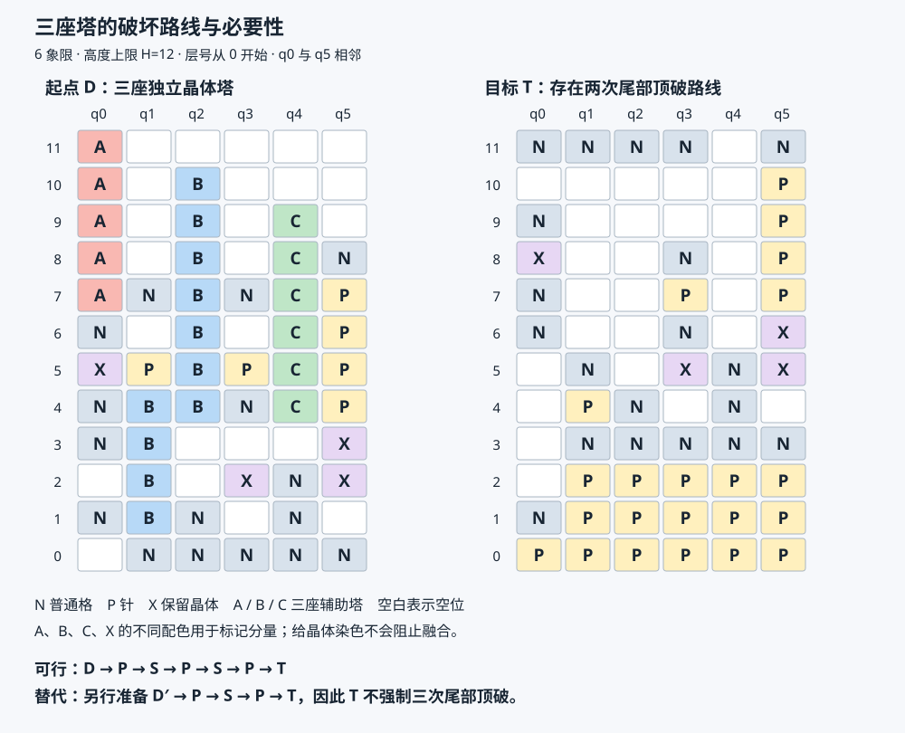

# 三座晶体塔的尾部构造与两次顶破替代

研究目标是：最后一次Swap之后，是否存在完整目标，必须顶破三个不同晶体融合分量，并在破坏事件之间Stack。P表示Pin，S表示单层Stack；半形与上料允许提前制造，工作高度上限固定。晶体颜色不影响融合。

**本页给出六象限十二层的真实三塔路线，但它不是全局三次顶破的必要实例。** 同一个目标既能把两次上料合并，又能把第一次顶破移入两半准备，最终尾部只需P→S→P。这个明确的替代证书排除了本候选，同时给出下一次构造必须处理的两个障碍。

已有[T₃](t3-forced-order.md)最短词为P→S→P→P，其第三次Pin只抬升，不提供第三座有效塔。它也不能满足这里的要求。

## 1. 同层独立晶体分量的宽度限制

设偶数n象限的某一层有k个不同晶体融合分量。不同分量的C不能水平相邻，因此

`k ≤ n/2`。

证明：k≤1时结论直接成立。k≥2时，沿环给每个出现的分量取一个C段，每两段之间至少隔一个非C格；否则它们融合。所需格数至少2k。一个分量占多个段或在别层相连，只会减少分量数。

特别地，若三座将依次顶破的塔在同一来源层都有C，它们至少需要六象限。四象限不能把这样的三座塔直接并排放下。

若三座初始分量在前三次Pin中分别顶破、此前不下落碎裂，则其初始最高层分别为H−1、H−2、H−3。若三个分量的最低层都不高于H−3，晶体连通路径的高度不能跳层，三个分量都必经过H−3，遂需要n≥6。更多塔同理：共同经过一层的k座独立塔需要n≥2k。

这是对同时贯穿公共高度的塔的几何限制。没有证明所有强制构造都必须满足这个前提，也没有证明四象限最多两次有效顶破；高度错开的分量及其他支撑交接仍需单独分析。

## 2. 六象限十二层候选

层号从0开始，q0与q5相邻。N取Cu，P为针。A、B、C标记三座辅助塔，X为最终保留的晶体；四种字母在短代码里都使用cr。



起点D：

```text
 z   q0 q1 q2 q3 q4 q5
11    A  .  .  .  .  .
10    A  .  B  .  .  .
 9    A  .  B  .  C  .
 8    A  .  B  .  C  N
 7    A  N  B  N  C  P
 6    N  .  B  .  C  P
 5    X  P  B  P  C  P
 4    N  B  B  N  C  P
 3    N  B  .  .  .  X
 2    .  B  .  X  N  X
 1    N  B  N  .  N  .
 0    .  N  N  N  N  N
```

```text
D = --CuCuCuCuCu:CucrCu--Cu--:--cr--crCucr:Cucr------cr:CucrcrCucrP-:crP-crP-crP-:Cu--cr--crP-:crCucrCucrP-:cr--cr--crCu:cr--cr--cr--:cr--cr------:cr----------
```

三座塔的晶体集合为：

- A：q0第7至11层。
- B：q1第1至4层，连着q2第4至10层。
- C：q4第4至9层。

保留晶体为q0第5层、q3第2层、q5第2和3层。它们与三座塔没有晶体融合边。A、B、C可以通过同行普通格属于同一个非针粘连组；这不使它们成为同一个晶体融合分量，顶破仍分别删除。

### 起点的制造凭据

按q0/q1/q2与q3/q4/q5准备两半。六列均满足[列条件A](angle-synthesis.md#1-不按完整列字串分类的必要条件)。左半的B由q1地面N支撑；q0第3、4层N接到B，托住保留C及其上方N、A；q1第7层N也接到B。右半的低处X由q4第2层N支撑；q5的四根针和第8层N托住C，q3第4、7层N接到C，第5层针有直接下邻。因此两半都静止。

两半都通过[固定方向脚手架](scaffold-halves.md)：左半依次剥离q0、q1、q2，在右侧补普通柱；右半依次剥离q3、q4、q5，在右侧补普通柱。首轮剩余的两列均保持上述支撑，并取得新柱支撑；第二轮只剩一根目标列及普通柱。因此可用已有参数角程序反向恢复，得到同H的基础料制造树，而非只假设稳定半形可制造。

## 3. 三次顶破与两次上料的真实路线

使用单层上料：

```text
U01 = CuCu--------
U23 = ----CuCu----
```

路线为：

`D → P₁ → S(U01) → P₂ → S(U23) → P₃ → T`。

逐段核对：

1. P₁顶破A。B的顶端从10升到11，C的顶端从9升到10。q0最高N为7，q1最高N为8，所以U01落在第9层。
2. P₂顶破B。U01提高到第10层，与q5旧N同层连接，借q5针链固定。q0原第1层N落到地面；q1原第5层针及第7层N分别落到3、4层。C仍由q5旧N与针链托住，其顶端升到11；q3原第7层N仍由C托住，位于第9层。
3. 此时q2最高N在第3层，q3最高N在第9层，故U23落在第10层。它接到已有q1屋顶，与q5的固定支撑连通。
4. P₃顶破C。q3原第4层N、原第5层针及原第7层N在这次抬升后先位于7、8、10层，失去侧向支撑，依次落到6、7、8层。q3第5层保留X由q4第5层N预先支撑，成为这串落位的挡块。第11层屋顶通过q5第10层针固定，其余保留材料不动。

这里最后一次Pin确实删除了第三个不同分量，并造成新的下落。

目标T：

```text
 z   q0 q1 q2 q3 q4 q5
11    N  N  N  N  .  N
10    .  .  .  .  .  P
 9    N  .  .  .  .  P
 8    X  .  .  N  .  P
 7    N  .  .  P  .  P
 6    N  .  .  N  .  X
 5    .  N  .  X  N  X
 4    .  P  N  .  N  .
 3    .  N  N  N  N  N
 2    .  P  P  P  P  P
 1    N  P  P  P  P  P
 0    P  P  P  P  P  P
```

```text
T = P-P-P-P-P-P-:CuP-P-P-P-P-:--P-P-P-P-P-:--CuCuCuCuCu:--P-Cu--Cu--:--Cu--crCucr:Cu----Cu--cr:Cu----P---P-:cr----Cu--P-:Cu--------P-:----------P-:CuCuCuCu--Cu
```

## 4. 两次上料能合并

省去第一次上料，连续执行P₁、P₂，记结果为E。原屋顶q5第10层N仍存在，q3第9层N仍被C托住。q0、q1、q2、q3的列顶依次为8、4、3、9。

因此一份单层四连N

`U0123 = CuCuCuCu----`

恰落在第10层，形成与原两份上料完全相同的四格屋顶。它横向接到旧q5屋顶。P₂中的低处落位不依赖被省略的U01：C与保留X的固定支撑均已由旧材料提供。

所以同一个D具有更短路线：

`D → P → P → S(U0123) → P → T`。

两份上料在最终同层相邻，较晚阶段的q3高落点足以一次托住全部四格。前一座塔封住过q0，并不能阻止等待第二座塔打开后共同上料。

## 5. 首次顶破还能移入两半准备

设D的两个合法半形为L、R。分别对它们Pin，再Swap，得到D′。

D中的任何晶体融合分量都没有跨越这条切线；首次Pin删除左半A，右半没有触顶C。删除和抬升后，两半内部的支撑仍独立成立：左半由B与原底N保持，右半由低处X、q5针链和旧N保持。没有需要另一半才能停止的下落。两半相拼的全部组也保持这些接地支撑。

所以

`D′ = Swap(P(L), P(R)) = P(D)`。

两个Pin的输入、输出均限于原三列半面，输出静止，最后Swap的预切也不改变它们。制造全过程仍不超过H=12。

结合第4节，得到同目标的两次尾部顶破证书：

`D′ → P（删除B）→ S(U0123) → P（删除C）→ T`。

A的删除发生在最后Swap之前，不计入尾部。由此已经足以证伪“这个T必须三次尾部顶破”；不必先求出T的最短配方。本页只得到其全局尾部Pin最小值不超过2，没有声称恰等于2。

这个替代也说明：只有“一条路线包含三座塔”还不够。若一次破坏及其下落能分别在两半里完成，它就可能被预制吸收。要排除这种替代，需要目标本身迫使跨切向支撑交接，或其他不能通过选择合法起点提前完成的约束。

## 6. 对后续构造的约束

三次不同顶破是值得继续研究的机制目标，比给T₃追加无破坏抬升更直接。上述候选把机械路线做到了三次真实删除，但两项必要性均有明确绕过证书。后续候选需分别证明：

- 每次关键事件不能通过更换最后Swap起点而提前准备；对一个切向的困难，还必须覆盖其他切向。
- 每个中间Stack段既不能前移，也不能后移或与另一个段合并；相邻同层普通块尤其容易共用后一个落脚点。
- 三个事件不能同时融合删除或以别的支撑释放替代；不同颜色并不能隔离晶体融合。

共同高度的三塔下界解释了本候选为何用六象限，但增加宽度也使半形能独立容纳更多辅助结构，从而容易提前处理。因此本页没有宣布六象限必然能实现全局三事件，也没有排除四象限的其他结构。

原来的任意指定Pin/Stack序列命题，以及这里更具体的全局三破坏实例，仍未解决。

证据为人工逐格推导、半形脚手架制造定理和物理规则静态对照。格子图与短代码只是所列矩阵的转写；未运行测试、求解器、枚举、物理模拟或游戏，未修改Python求解器和电路。
